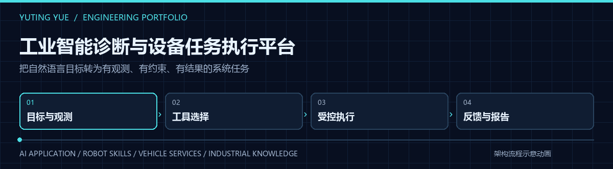
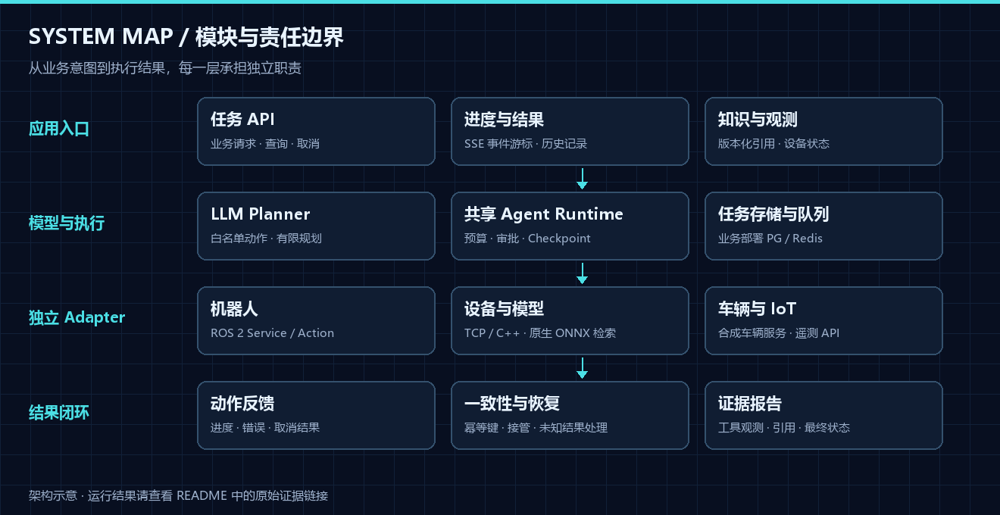
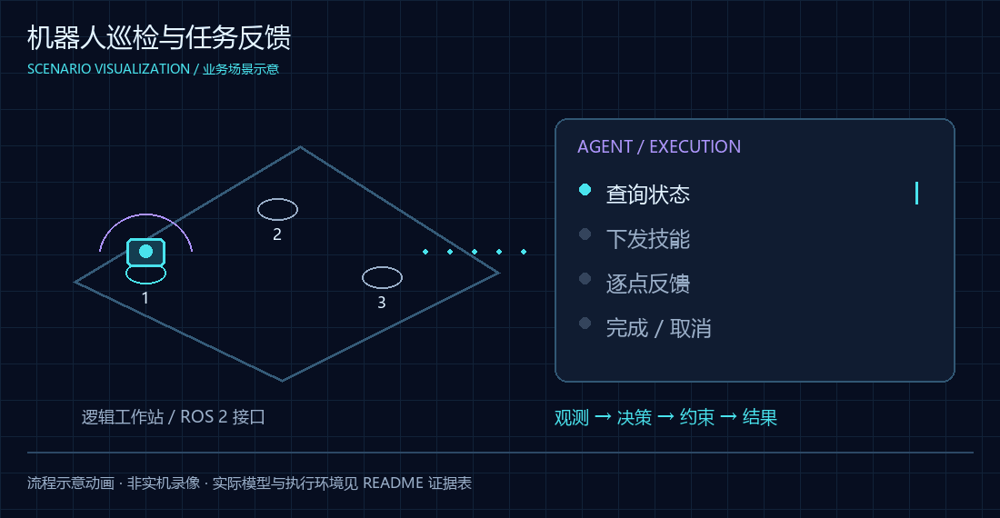
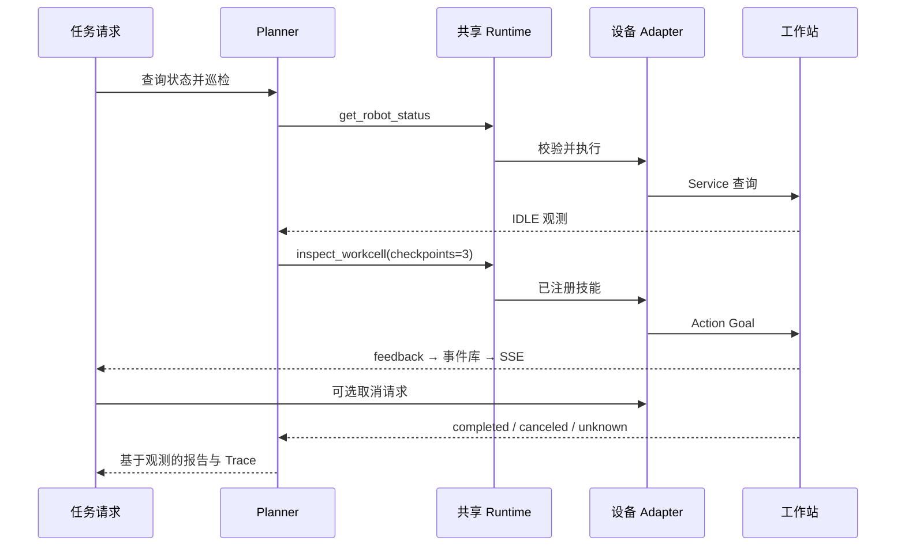
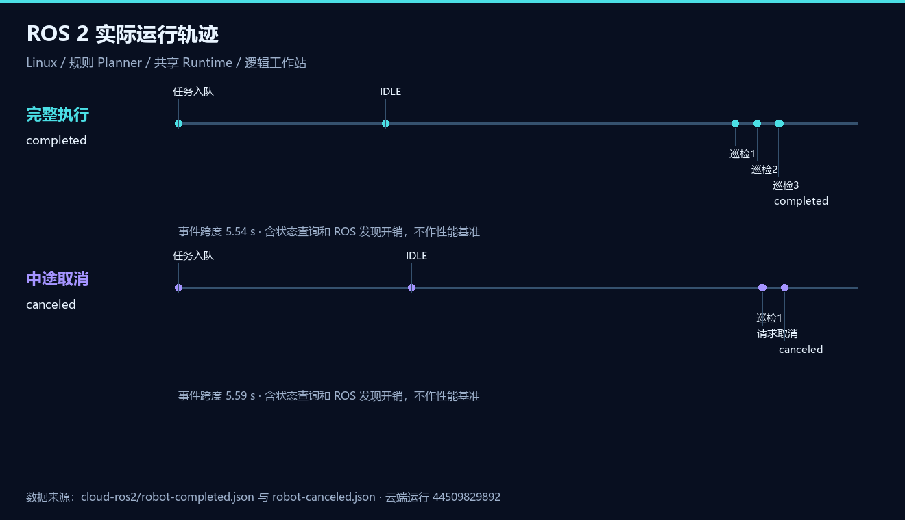
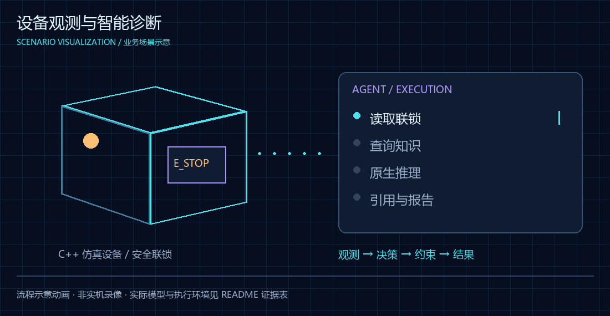
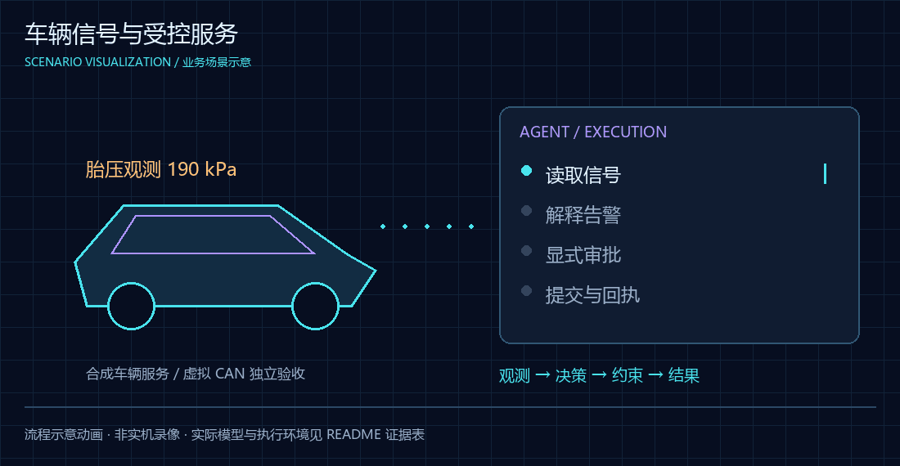

# 工业智能诊断与设备任务执行平台



<sub>架构流程示意动画 · [静态版本](docs/assets/overview.png) · 动画不作为实测结果。</sub>

[返回技术作品集](https://github.com/KristenYue/KristenYue) · [机器人业务](https://github.com/KristenYue/telecom-network-incident-agent/blob/main/docs/ROBOT_DELIVERY.md) · [原生模型 SDK](https://github.com/KristenYue/edge-device-verification-lab/tree/main/inference_sdk) · [车辆 Agent](https://github.com/KristenYue/telecom-network-incident-agent/blob/main/docs/VEHICLE_ADAPTER.md)


**Python · FastAPI · LLM / RAG · Agent Runtime · PostgreSQL · Redis Streams · ROS 2**

[](https://github.com/KristenYue/telecom-network-incident-agent/actions/workflows/ci.yml)

输入自然语言任务，系统查询设备或车辆状态、检索知识、选择已注册技能、执行受控动作，并保存**进度、工具观测、知识来源和最终结果**。本仓库负责业务应用和 Adapter；执行内核复用独立 Runtime，设备控制与原生推理复用 C++ 仓库。

## 从哪个模块开始看

| 岗位方向 | 业务闭环 | 深入入口 |
|---|---|---|
| **机器人 AI 应用 / 后端 / 任务平台** | 查询工作站 → 三点巡检 → 进度反馈 → 完成或取消 → 报告 | [机器人模块](docs/ROBOT_DELIVERY.md) · [任务服务](src/telecom_incident_agent/robot_tasks.py) · [ROS Adapter](src/telecom_incident_agent/robot_ros.py) |
| **AI 芯片应用 / 模型 SDK / 工业研发软件** | C++ 设备观测 → 原生 BGE 知识检索 → 带引用诊断 | [联合运行结果](docs/evidence/native-llm-live.json) · [原生推理 SDK](https://github.com/KristenYue/edge-device-verification-lab/tree/main/inference_sdk) |
| **车载 Agent / 智能终端应用 / 端云平台** | 胎压信号 → 知识解释；只读 Agent → 项目一真实 SOME/IP `VehicleSnapshot` / DTC；写请求 → 审批 → 幂等提交 | [车辆模块](docs/VEHICLE_ADAPTER.md) · [跨项目适配器](src/telecom_incident_agent/sdv_services.py) |

## 架构与模块职责



业务不是一条固定的工具调用流水线：**Planner 根据已有观测决定下一步，工具与执行层独立约束参数、前置状态和权限**。机器人本地演示使用单后台 Worker + SQLite；通信诊断部署路径使用 PostgreSQL / Redis。两条路径复用执行内核，部署语义分别说明。

## 三个核心工程难点

| 难点 | 核心设计 | 解决的问题与源码 |
|---|---|---|
| **模型决策如何落到设备能力** | 工具注册表 + Pydantic 参数契约 + 观测约束；机器人技能执行前读取状态，只对显式 `retry_safe` 失败允许有限重试 | 防止跳过前置观测、非法参数和未知副作用重放。[Planner 与任务](src/telecom_incident_agent/robot_tasks.py) · [技能接口](src/telecom_incident_agent/robot_skills.py) |
| **长动作怎样表达进度、取消与结果** | ROS 2 Action Adapter 将 feedback 写为持久化事件；取消只是请求，终态依据执行器；提交或结果超时保留 `result_unknown` | 区分“已取消”“已完成”“结果未知”。SSE 以数据库事件 ID 续读，每批最多 100 条。[ROS](src/telecom_incident_agent/robot_ros.py) · [API](src/telecom_incident_agent/robot_api.py) |
| **崩溃和重复投递怎样保持一致性** | PostgreSQL 保存业务与执行状态，Redis Streams 保留 Pending；`XAUTOCLAIM` 回收，Checkpoint / 工具账本 / Fencing 约束接管后的写入 | 消息允许重投，结果提交受执行代际约束；超限转死信。[可靠任务设计](docs/RELIABLE_JOBS.md) · [Worker](src/telecom_incident_agent/worker.py) |

## 机器人：目标到技能执行



<sub>场景示意动画，非实机录像；实际执行环境与结果见下方证据。[静态图](docs/assets/robot-task-flow.png)</sub>



| 已运行实验 | 实际结果 | 原始证据 |
|---|---|---|
| **真实模型 + 逻辑工作站** | 3 次模型决策，2 次工具调用，三点巡检完成，报告持久化 | [robot-live.json](docs/evidence/robot-live.json) |
| **Linux ROS 2 + 规则 Planner + 共享 Runtime** | 状态 `IDLE` → 巡检 **3/3** → 3 条逐点反馈 → `completed` | [robot-completed.json](docs/evidence/cloud-ros2/robot-completed.json) |
| **同一 ROS Adapter 的取消分支** | 在 **1/3** 点请求取消，执行器返回 `canceled`，终态与事件一致 | [robot-canceled.json](docs/evidence/cloud-ros2/robot-canceled.json) |
| **ROS 基础接口** | Topic / Service 查询通过，8 点巡检完成与中途取消通过 | [8 点结果](docs/evidence/cloud-ros2/completed.json) · [取消结果](docs/evidence/cloud-ros2/canceled.json) · [CI](https://github.com/KristenYue/telecom-network-incident-agent/actions/runs/44509829892) |

两组规划器分别验收：真实模型当前运行于逻辑工作站；ROS 2 路径使用规则 Planner。图中展示共用接口架构，联合真实模型 + ROS 2 运行尚未作为已完成成果。



## 芯片与工业软件：模型接口到设备诊断



<sub>场景示意动画，非实机录像；实际执行环境与结果见下方证据。[静态图](docs/assets/equipment-diagnosis-flow.png)</sub>

**业务问题：** “设备为什么不能启动？”系统先经 TCP 查询 C++ 仿真设备，观察安全联锁，再调用知识工具生成有出处的解释。

**技术链：** LLM → 工具注册 → C++ TCP 快照 → Python Tokenizer → C++ / ONNX BGE Embedding → 知识条目与版本 → 结构化诊断。

- [实际联合轨迹](docs/evidence/native-llm-live.json)：2 次工具调用，知识工具明确返回 `retrieval_backend=native_onnx`，最终 `completed`。
- [检索实现](src/telecom_incident_agent/knowledge.py)：BM25 / 向量检索、RRF 融合及过滤；配置原生模型路径后接入 NativeEmbedder，缺失配置明确报错。
- [原生 SDK 数值对齐](https://github.com/KristenYue/edge-device-verification-lab/tree/main/inference_sdk)：预训练 BGE 输出 `3×512`，最大绝对误差 `1.53e-7`。
- Runbook 保存文档身份和版本，让结论能追溯到当时采用的知识；它承担**知识来源和领域约束**，模型与工具调用承担实际推理和执行。

## 智能汽车：观测、审批与服务调用



<sub>场景示意动画，非实机录像；实际执行环境与结果见下方证据。[静态图](docs/assets/vehicle-service-flow.png)</sub>

| 模块 | 实际完成 | 证据 |
|---|---|---|
| 车辆 Agent | 真实模型完成胎压解释与空调 22℃请求；写操作先进入 `waiting_review`，演示显式批准后完成 | [vehicle-live.json](docs/evidence/vehicle-live.json) |
| Agent × 车载平台 | 共享 Runtime 经有界 SOME/IP 直接读取项目一 `vehicle.state` 与 `vehicle.diagnostics`；CI 启动真实 C++ 服务，不使用 Mock | [适配器](src/telecom_incident_agent/sdv_services.py) · [验收脚本](scripts/run_sdv_agent_integration.py) |
| 信号接口 | 项目 DBC 子集解码车速、电量、车门、胎压；未知 ID、DLC 和越界值拒绝 | [vehicle-dbc.json](docs/evidence/vehicle-dbc.json) |
| 虚拟总线 | Linux `AF_CAN` / `vcan0` 实际收发，解出左前轮 190 kPa | [Linux 原始结果](docs/evidence/cloud-vcan/linux-vcan.json) · [CI](https://github.com/KristenYue/telecom-network-incident-agent/actions/runs/44505903871) |
| 状态一致性 | 采样时间控制新鲜度；迟到补传不覆盖新状态；仿真控制账本与状态同事务提交 | [vehicle.py](src/telecom_incident_agent/vehicle.py) · [模块说明](docs/VEHICLE_ADAPTER.md) |

## 运行方法

Python 3.11 / 3.12，在仓库根目录执行：

```bash
python -m venv .venv
# Windows: .venv\Scripts\activate
# Linux: source .venv/bin/activate
python -m pip install -e '.[dev]'
python scripts/demo_robot_agent.py --baseline --output .runtime/robot-baseline.json
python scripts/demo_robot_agent.py --baseline --cancel-after 1 --output .runtime/robot-cancel.json
python scripts/demo_vehicle.py --output .runtime/vehicle-baseline.json

# 先构建相邻仓库 sdv-communication-integration-lab，再把服务端路径传入：
python scripts/run_sdv_agent_integration.py \
  --sdv-server ../sdv-communication-integration-lab/build/sdv_someip_vehicle_server \
  --output .runtime/sdv-agent-integration.json
```

真实模型需在本机配置 `TELECOM_MODEL_BASE_URL`、`TELECOM_MODEL_ID`、`TELECOM_MODEL_API_KEY`，密钥只通过环境变量读取：

```bash
python scripts/demo_robot_agent.py --output .runtime/robot-live.json
python scripts/demo_vehicle.py --live-model --output .runtime/vehicle-live.json
```

机器人 API：`robot-agent-api`；[ROS 2 构建与运行](docs/ROBOT_DELIVERY.md)、[车辆模块](docs/VEHICLE_ADAPTER.md)、[工业设备指南](docs/INDUSTRIAL_AGENT.md)、[部署与可靠任务](docs/RELIABLE_JOBS.md)。原生联合演示还需构建 C++ 设备、安装 SDK，并配置 `EDGE_AI_MODEL_PATH` / `EDGE_AI_TOKENIZER_PATH`；见 [SDK](https://github.com/KristenYue/edge-device-verification-lab/tree/main/inference_sdk) 与 [脚本参数](scripts/demo_native_llm.py)。

## 运行证据与工程复盘

[完整源码—结果索引](docs/EVIDENCE_INDEX.md) · [通信诊断证据](docs/EVIDENCE_CARD.md) · [架构](docs/ARCHITECTURE.md) · [Bad Case](docs/BAD_CASES.md)

评测边界：`telecom-synthetic-v2` 使用项目自建合成数据，包含 240 条 development 输入与冻结前 100 条输入。工具白名单是 Agent 执行边界，而不是**身份认证或 RBAC**。不要把这些合成离线结果表述为运营商生产网效果；指标定义、数据划分和原始证据见 [EVIDENCE_CARD.md](docs/EVIDENCE_CARD.md)。

| 典型问题 | 工程处理 |
|---|---|
| ROS 2 Topic / Action 发现存在启动时序 | 显式类型、等待服务就绪、设置发现期限并保留启动日志 |
| 独立 ROS Context 使用全局 Executor | 为每次传输创建绑定同一 Context 的 Executor，统一资源销毁顺序 |
| 取消与完成竞争 | 记录 `cancel_requested`，以 Action 返回决定最终状态 |
| Worker 中断后旧执行者恢复 | 使用租约代际与 Fencing，拒绝陈旧写入；外部未知副作用不盲目重放 |

<details>
<summary>环境与结果口径</summary>

设备及机器人为软件仿真，车辆为合成服务与虚拟 CAN，原生模型为 CPU 执行。ROS 2 是逻辑工作站，不含物理导航。PG / Redis 的真实服务验收属于通信诊断部署路径；机器人本地任务层为 SQLite 单 Worker。SSE 当前有端点契约与续读检查，未作为 HTTP 压测成果。通信故障实验来自项目自建数据；知识引用与权限白名单不等同于生产权限系统。

</details>


---

文档与结果口径：2026-11-19。功能以对应源码和运行记录为准；场景、执行环境和数据来源随结果一并标注。
