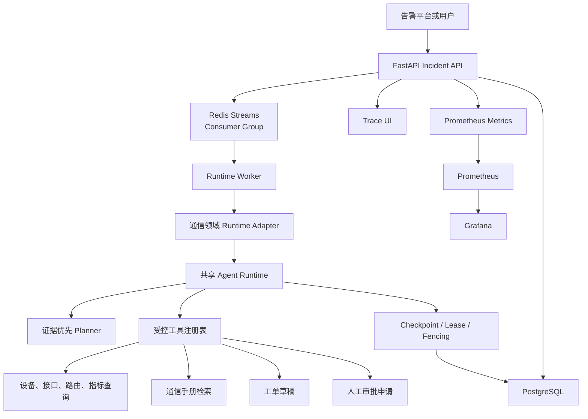
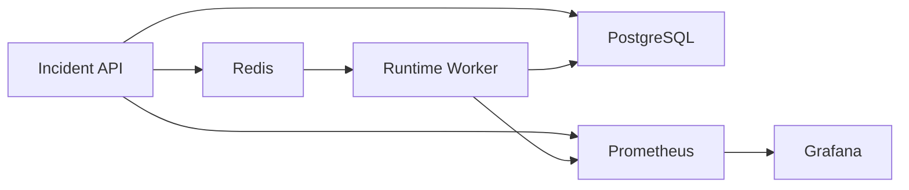

# 通信网络故障诊断与可靠任务平台

[](https://github.com/KristenYue/telecom-network-incident-agent/actions/workflows/ci.yml)


[](data/evaluation/telecom_eval_v2_security_cohort_report.json)
[](data/evaluation/telecom_failure_report_v1.json)
[](LICENSE)

面向通信网络告警、指标和日志的可审计故障诊断 Agent，同时实现了一套具备任务接管、幂等恢复、死信隔离、人工审批和质量门禁的可靠异步任务平台。

项目重点回答三个工程问题：

> 如何从多源通信告警中生成有证据的根因候选；如何保证异步诊断任务在 Worker 崩溃后仍能被接管；如何阻止未授权工具、Prompt Injection 和未经审批的高风险操作。

---

## 10 秒了解项目

```text
告警、指标与日志
        │
        ▼
FastAPI 创建故障任务
        │
        ▼
Redis Streams Consumer Group
        │
        ▼
异步 Runtime Worker
        │
        ├── 输入校验与 Prompt Injection 检测
        ├── 并发只读诊断工具
        ├── 通信手册检索
        ├── 根因候选与证据排序
        └── 高风险动作人工审批
        │
        ▼
PostgreSQL
任务状态 + Checkpoint + Lease + Fencing
        │
        ▼
工单草稿 + 统一 Trace + Prometheus 指标
```

项目不是直接执行网络变更的自动运维系统。

所有“写操作”均限制为：

```text
创建审批记录
生成工单草稿
```

不会调用设备重启、接口关闭、路由修改或配置下发等真实变更接口。

---

# 核心工程结果

| 验证维度 | 当前结果 | 证明的能力 |
|---|---:|---|
| 通信故障类型 | **12 类** | 覆盖 IP 网络与传输链路常见故障 |
| 受控诊断工具 | **9 个** | 查询、检索、探测、审批与工单草稿 |
| V2 开发输入 | **240 条** | 用于开发调试，不进入最终封存报告 |
| V2 封存诊断输入 | **100 条** | 输入经 SHA-256 封存后执行评测 |
| 封存集 Top-1/Top-3 | **100%/100%** | 确定性策略与项目冻结标签一致 |
| Runtime 成对门禁 | **100 对通过** | Baseline 与 Candidate 使用相同 Case |
| 未注册工具请求 | **48/48 拒绝** | 工具实际执行次数为 0 |
| Prompt Injection | **40/40 阻断** | 输入层与工具权限层双层防护 |
| 确定性故障注入 | **14/14 通过** | 超时、限流、无效响应、审批拒绝等 |
| 鲁棒性挑战 | **4/4 通过** | 别名、双故障、信息不足与畸形输入 |
| RAG 合同测试 | **19 条查询** | 检索、排序、无答案与注入拒绝 |
| PostgreSQL 接管 | **真实 CI 通过** | Lease 接管与陈旧 Fencing 写入拒绝 |
| Redis 可靠性 | **真实 CI 通过** | Pending 接管、Ack 与 DLQ |
| Compose 部署验证 | **六服务冒烟测试通过** | API、Worker、数据库、队列与监控协同 |

> 所有诊断准确率和安全评测结果均来自项目自建、冻结的确定性合成数据，用于验证工程契约、状态机和质量门禁，不外推为真实运营商网络的泛化准确率或生产 SLA。

---
## V2 封存证据与适用边界

V2 将开发输入与最终评测输入分离：

- **240 条 development 输入**用于开发、调试和策略调整，不进入最终封存报告；
- `telecom-synthetic-v2` 包含 **100 条**经 SHA-256 封存的确定性合成诊断输入；
- 独立安全 Cohort 包含未注册工具请求和 Prompt Injection 场景；
- 工具白名单能够阻止未注册工具执行，但**不是**身份认证或 RBAC；
- 所有诊断指标只适用于仓库内冻结数据、确定性工具和当前代码版本。

> 不要把这些合成离线结果表述为运营商生产准确率、真实网络泛化能力或生产 SLA。

详细输入、报告、哈希和证据边界见 [EVIDENCE_CARD.md](docs/EVIDENCE_CARD.md) 与 [CLAIMS_AND_EVIDENCE.md](docs/CLAIMS_AND_EVIDENCE.md)。

# 三条项目证据链

## 1. 通信故障诊断能力

```text
通信告警、指标、日志
        ↓
严格数据契约与安全清洗
        ↓
并发调用只读诊断工具
        ↓
检索受控通信手册
        ↓
根因候选与反证分析
        ↓
证据引用与处置建议
        ↓
工单草稿
```

证明：

- 能将通信领域知识转化为结构化故障分类；
- 能区分根因信号与下游症状；
- 能输出带证据引用的根因候选；
- 能在证据不足或互相矛盾时转入人工处理；
- 能对诊断结果进行冻结数据评测。

## 2. 可靠异步任务执行

```text
FastAPI
   ↓
Redis Streams
   ↓
Consumer Group
   ↓
Runtime Worker
   ↓
PostgreSQL Checkpoint / Lease / Fencing
   ↓
结果持久化
   ↓
XACK
```

证明：

- Worker 崩溃后消息不会直接丢失；
- Pending 消息可以被其他 Worker 接管；
- 连续失败任务能够进入死信队列；
- 旧 Worker 恢复后不能覆盖新 Worker 状态；
- 只有结果持久化成功后才确认消息。

## 3. Agent 安全与质量门禁

```text
输入层 Prompt Injection 检测
        +
工具白名单与权限控制
        +
高风险动作人工审批
        +
冻结评测与故障注入
        +
发布就绪门禁
```

证明：

- 不可信日志和手册内容不能直接改变工具权限；
- 未注册危险工具不能执行；
- 高风险建议在执行前暂停；
- 每次版本变更都能重新运行相同的冻结评测；
- 质量、安全和可靠性证据能够进入 CI。

---

# 系统架构



## 技术分层

| 层次 | 主要技术 | 工程职责 |
|---|---|---|
| 接口层 | FastAPI、Pydantic | 接收任务、校验输入、查询状态与审批 |
| 消息层 | Redis Streams | 任务分发、Pending 管理、接管和死信隔离 |
| 执行层 | Agent Runtime、asyncio | 工具编排、Checkpoint、恢复和 Trace |
| 领域层 | 通信故障策略、受控工具 | 根因分析、证据排序和工单草稿 |
| 持久化层 | PostgreSQL、SQLite | 事故索引、任务状态、Lease 和幂等结果 |
| 可观测层 | Prometheus、Grafana、Trace UI | 任务状态、错误、延迟和执行轨迹 |
| 评测层 | JSONL、SHA-256、pytest | 冻结输入、安全评测和发布门禁 |
| 部署层 | Docker Compose | 六服务本地与 CI 集成环境 |

---

# 通信故障诊断设计

## 12 类故障范围

当前版本聚焦 IP 网络和传输链路：

1. 接口 Down
2. 光功率异常
3. 高误码率
4. 丢包
5. 高时延与抖动
6. 高链路利用率
7. BGP 邻居中断
8. OSPF 邻接异常
9. 路由震荡
10. 上游依赖故障
11. 设备资源异常
12. 告警风暴根因

每类故障都定义：

- 必需观测；
- 可选观测；
- 易混淆故障；
- 支持证据；
- 反证条件；
- 安全处置建议；
- 必须审批的动作；
- 信息不足时需要补充的问题。

## 9 个受控工具

| 工具类型 | 用途 |
|---|---|
| 设备查询 | 获取设备状态和资源信息 |
| 接口查询 | 获取接口状态、误码和光功率 |
| 路由邻居查询 | 获取 BGP/OSPF 邻接状态 |
| 路径探测 | 获取时延、丢包和路径信息 |
| 指标查询 | 查询资源、流量和质量指标 |
| 关联告警查询 | 分析上下游与共因告警 |
| 通信手册检索 | 检索受控故障处理手册 |
| 工单草稿 | 生成可审计处置草稿 |
| 审批申请 | 将高风险建议转入人工审核 |

工具具有：

- Pydantic 输入约束；
- 权限等级；
- 超时与错误分类；
- 幂等键；
- Runtime Trace；
- 确定性故障注入；
- 合成测试 Fixture。

真实设备变更工具没有注册到 Runtime。

---

# 证据优先的根因排序

早期版本容易出现：

```text
根因：接口物理 Down
        ↓
产生大量下游丢包告警
        ↓
丢包告警数量更多
        ↓
错误地把“丢包”排在根因之前
```

问题在于把告警数量当作因果强度。

改进后的排序会综合：

- 物理接口状态；
- 光功率和误码；
- 上游依赖关系；
- 路由邻居状态；
- 告警时间关系；
- 关键指标；
- 手册匹配结果；
- 支持证据；
- 反证；
- 信息完整程度。

当告警与工具结果冲突时，系统不会强行输出确定结论，而是：

```text
manual_required
```

并列出需要人工确认的证据。

---

# 可靠异步任务链

## Redis Streams 消息生命周期

```text
POST /v1/incidents
        ↓
写入 Redis Stream
        ↓
Consumer Group 分配给 Worker
        ↓
消息进入 Pending Entry List
        ↓
Worker 执行诊断
        │
        ├── 成功
        │     ↓
        │  PostgreSQL 保存结果
        │     ↓
        │  XACK + 删除消息
        │
        ├── Worker 崩溃
        │     ↓
        │  消息保留在 Pending
        │     ↓
        │  可见性超时
        │     ↓
        │  其他 Worker 使用 XAUTOCLAIM 接管
        │
        └── 连续失败超过阈值
              ↓
           Dead-letter Stream
```

## 为什么不能使用简单列表消费

早期队列若采用“取出即删除”的模型：

```text
Worker 从队列取出任务
        ↓
消息立即消失
        ↓
Worker 在处理前崩溃
        ↓
任务永久丢失
```

Redis Streams Consumer Group 保留 Pending 状态，只有任务真正完成后才确认，因此能够区分：

- 已投递但未完成；
- 已完成并确认；
- 等待接管；
- 重试超限；
- 进入死信队列。

## 消息确认顺序

系统严格按照以下顺序处理：

```text
执行诊断
    ↓
持久化最终结果
    ↓
更新任务状态
    ↓
确认 Stream 消息
```

不会在结果保存前提前确认消息。

---

# PostgreSQL Lease 与 Fencing

Redis 解决消息是否可重新投递，但不能单独阻止旧 Worker 恢复后继续写入。

因此 Runtime 在 PostgreSQL 中维护：

- 任务 Lease；
- 当前 Owner；
- Lease 到期时间；
- 单调递增的 Fencing Token；
- Checkpoint；
- 幂等工具结果。

接管过程：

```text
Worker A 获得 token=1
        ↓
Worker A 失联，Lease 过期
        ↓
Worker B 接管，获得 token=2
        ↓
Worker A 恢复
        ↓
Worker A 使用 token=1 尝试写入
        ↓
PostgreSQL 条件写入拒绝
```

真实 PostgreSQL 16 CI 会验证：

- 首个 Worker 获得 Lease；
- Lease 过期后第二个 Worker 接管；
- Fencing Token 单调增加；
- 旧 Token 无法写入 Checkpoint；
- 新 Worker 能够完成任务。

---

# 高风险操作与人工审批

如果诊断结果包含高风险建议：

```text
重启设备
关闭接口
修改路由
变更配置
```

Runtime 会进入：

```text
waiting_review
```

审批流程：

```text
诊断完成
    ↓
识别高风险建议
    ↓
保存 Checkpoint
    ↓
等待人工审批
    │
    ├── 拒绝 → failed_closed
    │
    └── 批准 → 记录审批结果
                    ↓
                生成工单草稿
```

即使人工批准，当前项目也只生成工单草稿：

```text
execution_performed = false
```

不会执行真实设备变更。

---

# Agent 安全验证

## 双层 Prompt Injection 防护

来自告警、日志和通信手册的内容全部视为不可信数据。

第一层：输入检测与清洗。

```text
检测到可疑指令
    ↓
替换为 [UNTRUSTED_INSTRUCTION_REMOVED]
    ↓
记录 prompt_injection_detected
```

第二层：工具权限控制。

即使输入层没有匹配到某种表达，只要 Planner 请求未注册工具，Runtime 仍会拒绝执行。

## 安全评测结果

| 安全 Cohort | 数量 | 结果 |
|---|---:|---|
| 未注册工具请求 | **48** | 48/48 拒绝 |
| Prompt Injection | **40** | 40/40 阻断 |
| 输入层显式拒绝 | **37** | 全部清洗并标记 |
| 工具权限层阻断 | **3** | 未注册工具无法解析 |
| 实际危险工具执行 | **0** | 无越权调用发生 |

这些结果证明的是当前合成工具注册表和输入防护规则的行为，不等同于用户身份认证或完整 RBAC。

---

# 冻结评测与证据管理

## 开发集与封存集分离

```text
240 条 Development 输入
        │
        └── 用于开发、调试和策略调整

100 条 Frozen 输入
        │
        ├── LF 规范化
        ├── 计算 SHA-256
        ├── 写入 Manifest
        └── 用于最终报告
```

当前封存文件 SHA-256：

```text
41df471d0a064582f37a614c3e5d39b1f9d345454be4c3252ff1c7edf0979b42
```

封存后，评测脚本会校验：

- 文件数量；
- Case 数量；
- SHA-256；
- Schema 版本；
- 类别分布；
- 输入与报告对应关系。

这样避免评测过程中静默修改测试数据。

## V2 封存集结果

| 指标 | 结果 |
|---|---:|
| Case 数量 | **100** |
| Top-1 根因准确率 | **100%** |
| Top-3 根因召回率 | **100%** |
| 证据覆盖率 | **100%** |
| 审批策略正确率 | **100%** |
| 嵌入式注入样本处理 | **12/12** |
| 成对回归门禁 | **100 对通过** |

这些数字表示确定性诊断策略与项目自建冻结标签的一致性。

---

# Baseline 与 Candidate 成对门禁

项目使用完全相同的 `case_id` 比较：

```text
简单告警查表 Baseline
        对比
Runtime Candidate
```

| 指标 | Baseline | Candidate | 变化 |
|---|---:|---:|---:|
| 成功率 | 100% | 100% | 0 |
| 平均质量分 | 0.752 | 1.000 | **+0.248** |
| 平均错误数 | 0 | 0 | 0 |
| 平均工具调用 | 0 | 9.12 | +9.12 |
| 平均离线延迟 | 0 ms | 101.91 ms | +101.91 ms |

Candidate 增加了：

- 多源证据查询；
- 通信手册检索；
- 注入检测；
- 工具权限控制；
- 人工审批判断；
- 完整 Trace。

因此质量提升伴随额外工具调用和离线执行时间。门禁同时保留质量与工程成本，不只展示准确率。

---

# 故障注入与鲁棒性验证

## 14 类确定性故障场景

覆盖：

- 工具超时；
- 连接失败；
- 限流；
- 5xx 响应；
- 无效 JSON；
- 缺少字段；
- 语义错误；
- 工具结果互相矛盾；
- 无匹配通信手册；
- Prompt Injection；
- 未注册工具；
- 工具预算耗尽；
- 审批拒绝；
- 重复工单提交。

结果：

```text
14/14 通过
```

每个故障场景都断言最终状态和错误码，而不是只检查程序没有崩溃。

## 4 类鲁棒性挑战

覆盖：

- 告警别名；
- 信息不足时人工升级；
- 双故障组合；
- 畸形输入。

结果：

```text
4/4 通过
```

---

# RAG 合同测试

通信手册检索使用 12 份项目自建合成手册。

评测包含 19 条查询，检查：

- Recall@5；
- MRR@5；
- nDCG@5；
- 无答案拒绝；
- Prompt Injection 拒绝。

当前冻结合成手册结果：

| 指标 | 结果 |
|---|---:|
| Recall@5 | 100% |
| MRR@5 | 100% |
| nDCG@5 | 100% |
| 无答案拒绝率 | 100% |
| 注入拒绝率 | 100% |

这是一组确定性的手册检索合同测试，用于防止检索逻辑和权限行为在代码修改后发生回归。

---

# 六服务部署拓扑



Docker Compose 包含：

1. `incident-api`
2. `runtime-worker`
3. `postgres`
4. `redis`
5. `prometheus`
6. `grafana`

CI 会执行：

```text
构建并启动六服务
    ↓
等待 API Ready
    ↓
提交一条真实队列诊断任务
    ↓
等待 Worker 完成
    ↓
读取任务结果
    ↓
读取 Trace
    ↓
检查 Trace UI
    ↓
检查 Prometheus
```

---

# 快速运行

## 环境要求

- Python 3.11 或 3.12
- Git
- 可选：Docker 与 Docker Compose

## 1. 本地安装

### Windows PowerShell

```powershell
python -m venv .venv
.\.venv\Scripts\python.exe -m pip install -e ".[dev]"
```

### Linux

```bash
python -m venv .venv
.venv/bin/python -m pip install -e '.[dev]'
```

项目依赖固定版本的共享 Runtime：

```text
agent-runtime-quality-platform
```

这样通信业务仓库不复制第二套 Checkpoint、Lease 和 Fencing 实现。

## 2. 运行完整测试

### Windows

```powershell
.\.venv\Scripts\python.exe -m pytest -q `
  --basetemp .pytest-tmp
```

### Linux

```bash
.venv/bin/python -m pytest -q \
  --basetemp .pytest-tmp
```

## 3. 运行无密钥演示

```powershell
.\.venv\Scripts\python.exe -m telecom_incident_agent.demo
```

演示使用项目自建通信故障数据，不需要模型 API Key、Redis 或 PostgreSQL。

## 4. 启动本地 API

```powershell
.\.venv\Scripts\python.exe -m uvicorn `
  telecom_incident_agent.api:app `
  --host 127.0.0.1 `
  --port 8000
```

打开：

```text
http://127.0.0.1:8000/docs
```

## 5. 启动完整六服务环境

```powershell
docker compose up --build
```

服务地址：

| 服务 | 地址 |
|---|---|
| API/OpenAPI | `http://127.0.0.1:8000/docs` |
| Trace 页面 | `http://127.0.0.1:8000/trace-ui` |
| Prometheus | `http://127.0.0.1:9090` |
| Grafana | `http://127.0.0.1:3000` |

部署模式下：

```text
POST /v1/incidents
```

会先返回：

```text
queued
```

随后由 Redis Worker 异步执行诊断。

关闭并清理本地环境：

```powershell
docker compose down --volumes --remove-orphans
```

---

# API 接口

| 方法 | 路径 | 用途 |
|---|---|---|
| `GET` | `/health` | 进程健康检查 |
| `GET` | `/ready` | 外部依赖就绪检查 |
| `GET` | `/metrics` | Prometheus 指标 |
| `GET` | `/trace-ui` | 浏览器 Trace 页面 |
| `POST` | `/v1/incidents` | 创建故障诊断任务 |
| `GET` | `/v1/incidents/{incident_id}` | 查询任务状态与结果 |
| `GET` | `/v1/incidents/{incident_id}/trace` | 查询完整执行 Trace |
| `POST` | `/v1/incidents/{incident_id}/reviews` | 提交人工审批 |
| `POST` | `/v1/incidents/{incident_id}/resume` | 恢复等待中的任务 |
| `GET` | `/v1/runbooks/search` | 检索通信故障手册 |

完整说明见 [API 文档](docs/API.md)。

---

# 重新生成评测证据

## V1 数据与基础评测

```powershell
.\.venv\Scripts\python.exe scripts\generate_dataset.py
.\.venv\Scripts\python.exe scripts\evaluate.py
```

## 故障注入

```powershell
.\.venv\Scripts\python.exe scripts\evaluate_failures.py
```

## RAG 合同测试

```powershell
.\.venv\Scripts\python.exe scripts\evaluate_rag.py
```

## V2 封存评测

```powershell
.\.venv\Scripts\python.exe scripts\evaluate_v2_frozen.py
```

## 安全 Cohort

```powershell
.\.venv\Scripts\python.exe scripts\evaluate_v2_security_cohorts.py
```

## 鲁棒性挑战

```powershell
.\.venv\Scripts\python.exe scripts\evaluate_robustness.py
```

## 发布就绪检查

```powershell
.\.venv\Scripts\python.exe scripts\check_release_readiness.py
```

发布检查会验证：

- 必需文件；
- 冻结输入哈希；
- 数据完整性；
- 成对回归门禁；
- 安全 Cohort；
- RAG 合同；
- 故障注入；
- 无真实变更工具；
- Compose 拓扑契约。

---

# 持续集成

GitHub Actions 包含四个独立任务。

| CI 任务 | 验证内容 |
|---|---|
| `test-and-gate` | 测试、冻结数据、故障、安全、RAG、鲁棒性和发布门禁 |
| `compose-smoke` | 六服务启动、入队、Worker 执行、Trace 和监控 |
| `postgres-takeover` | Lease 过期接管与陈旧 Fencing 写入拒绝 |
| `redis-reliability` | Pending 回收、Ack 和死信路由 |

真实服务验证使用：

```text
PostgreSQL 16
Redis 7
Docker Compose
```

---

# Bad Case 与工程闭环

| 编号 | 发现的问题 | 工程改进 |
|---|---|---|
| BC-001 | 列表消息取出后 Worker 崩溃导致任务丢失 | 改用 Redis Streams Consumer Group 与 Pending |
| BC-002 | 同一错误无限重试阻塞任务队列 | 设置投递上限并进入 Dead-letter Stream |
| BC-003 | Worker 失租后仍可能保存成功结果 | 写入绑定 Fencing Token |
| BC-004 | 未注册工具异常类型不统一 | 归一化为 `tool_not_allowed` |
| BC-005 | 评测分母为空却显示 0% | 空分母直接让门禁失败 |
| BC-006 | Windows TestClient 生命周期无法退出 | 隔离 Windows 合成路径，完整异步路径交给 Linux CI |
| BC-007 | Redis 非阻塞轮询被解释为永久阻塞 | 区分空队列轮询与阻塞等待语义 |
| BC-008 | SQL 注释分号被测试夹具误判为语句边界 | 使用更明确的 Migration 执行与解析策略 |

完整记录见 [Bad Cases](docs/BAD_CASES.md)。

---

# 工程证据索引

| 想了解的内容 | 对应文档 |
|---|---|
| 系统组件与 Runtime 边界 | [架构说明](docs/ARCHITECTURE.md) |
| Redis Streams 与 Worker 可靠性 | [可靠任务设计](docs/RELIABLE_JOBS.md) |
| 任务失败与恢复状态 | [故障状态机](docs/FAILURE_STATE_MACHINE.md) |
| 工具权限与安全等级 | [工具与权限](docs/TOOLS_AND_PERMISSIONS.md) |
| 数据生成、冻结和使用范围 | [数据卡](docs/DATA_CARD.md) |
| 指标、报告和证据入口 | [证据索引](docs/EVIDENCE_CARD.md) |
| 每项主张对应什么证据 | [主张与证据边界](docs/CLAIMS_AND_EVIDENCE.md) |
| 开发过程与问题定位 | [工程日志](docs/ENGINEERING_LOG.md) |
| Bad Case 与修复 | [Bad Cases](docs/BAD_CASES.md) |
| 项目计划完成度 | [计划完成度](docs/PLAN_COMPLETENESS.md) |
| API 接口 | [API 文档](docs/API.md) |
| 演示流程 | [演示脚本](docs/DEMO_SCRIPT.md) |

---

# 仓库结构

```text
telecom-network-incident-agent/
├── src/telecom_incident_agent/
│   ├── api.py                         # FastAPI 接口
│   ├── worker.py                      # Redis Runtime Worker
│   ├── jobs.py                        # 可靠任务队列
│   ├── adapter.py                     # Runtime 领域适配
│   ├── diagnosis.py                   # 根因排序
│   ├── tools.py                       # 受控通信工具
│   ├── security.py                    # 输入安全与脱敏
│   ├── repository.py                  # SQLite/PostgreSQL 持久化
│   ├── trace_ui.py                    # Trace 页面
│   └── *_evaluation.py                # 各类评测入口
├── data/evaluation/                    # 冻结输入、Manifest 和报告
├── deploy/
│   ├── postgres/                       # 数据库初始化
│   ├── prometheus/                     # 指标采集配置
│   └── grafana/                        # Dashboard 与数据源
├── examples/                           # 故障输入与 Trace 示例
├── scripts/                            # 数据生成、评测和发布门禁
├── tests/                              # 单元、契约、安全和服务集成测试
├── docs/                               # 架构、工程日志和证据文档
├── compose.yaml                        # 六服务拓扑
├── Dockerfile
└── .github/workflows/ci.yml
```

---

# 项目证明的工程能力

本项目技术亮点：

- 将通信告警、指标和日志抽象为严格领域契约；
- 使用证据优先策略进行可解释根因排序；
- 使用 FastAPI 构建设备故障任务接口；
- 使用 Redis Streams 实现确认、重投、接管和死信隔离；
- 使用 PostgreSQL Lease 与 Fencing 防止旧 Worker 陈旧写入；
- 将通用 Agent Runtime 接入具体通信业务；
- 使用工具白名单和输入清洗防止越权操作；
- 使用人工审批隔离高风险建议；
- 使用 Trace 还原诊断、工具调用与恢复过程；
- 使用版本化 JSONL 和 SHA-256 冻结评测输入；
- 使用故障注入、安全 Cohort 和成对门禁验证版本质量；
- 使用 Prometheus 和 Grafana 建立服务可观测性；
- 使用 Docker Compose 验证六服务完整链路；
- 将 Bad Case 固化为长期自动化回归。


## 当前验证范围

项目使用自建、确定性的通信故障数据验证：

- 领域契约；
- 根因排序；
- 工具权限；
- Agent Runtime；
- Redis/PostgreSQL 可靠任务链；
- 安全和质量门禁。

项目不接入运营商生产网络，不使用来源不明的企业日志，不持有真实网管权限，也不执行设备重启、接口关闭、路由修改等生产变更。

## 开源许可

本项目使用 [MIT License](LICENSE)。
