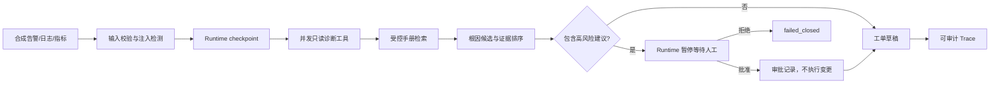

# 通信网络故障诊断 Agent

> Telecom Network Incident Diagnosis Agent

这是现有 **Agent Runtime & Evaluation Platform** 的第三个业务适配场景，不是另一套 Agent 平台。它把合成告警、指标与日志转换为可审计诊断任务，通过受控工具获取事实、检索合成运维手册、排列根因候选、生成工单草稿，并让高风险建议停在人工审批点。

当前版本为 `0.2.0`，已完成 C0–C3，并实现 C4 的六服务交付拓扑、监控面板和 Trace 页面。所有数据、工具响应和手册均为项目自建合成内容；没有连接运营商、网管平台或真实设备。本机没有 Docker，因此完整拓扑由契约测试覆盖，并交给 CI 做镜像构建与 Compose smoke test。

## 已完成能力

- 12 类 IP 网络与传输链路故障策略；
- 60 条冻结合成任务，12 类各 5 条；
- V2：240 条开发输入、100 条 SHA-256 封存合成输入与独立安全 cohort；
- 9 个带 Pydantic 参数校验、权限和故障注入的工具；
- 证据优先的确定性 Planner 与 Top-3 根因候选；
- 统一 Runtime checkpoint、lease、fencing、Trace 和幂等键；
- 高风险动作自动进入 `waiting_review`，拒绝时 `failed_closed`；
- 批准后只创建审批记录和工单草稿，绝不执行设备变更；
- Prompt Injection 检测、凭据脱敏、设备/接口白名单校验；
- 版本化 JSONL、跨平台 SHA-256 manifest 和成对发布门禁；
- 14 类确定性故障注入结果与最终状态断言；
- 计划中的 6 个 HTTP API 路由与 SQLite 审计索引。
- 可选 PostgreSQL 共享审计索引与 Runtime checkpoint/lease backend；
- Redis 作业队列和独立 Runtime Worker；
- `/trace-ui` 浏览器 Trace、Prometheus 指标与预置 Grafana dashboard；
- API、Worker、PostgreSQL、Redis、Prometheus、Grafana 六服务 Compose。

## 可复现结果

`telecom-synthetic-v1` 的 60 条确定性合成契约任务当前结果：

| 指标 | 结果 |
|---|---:|
| Top-1 根因准确率 | 100% |
| Top-3 根因召回率 | 100% |
| 证据覆盖率 | 100% |
| 审批策略正确率 | 100% |
| Prompt Injection 拒绝率 | 100% |
| 合成手册 Recall@5 / MRR@5 / nDCG@5 | 100% / 100% / 100% |
| Runtime 成对门禁 | 通过（60 对） |

这些数字只说明代码对**自己冻结的合成契约**满足预期，不代表真实网络泛化、生产 SLA 或运营商部署效果。简单 alarm lookup baseline 和 Runtime candidate 使用同一套五维质量口径；candidate 的优势来自证据、注入拒绝和审批策略，而不是把不同口径的分数硬比较。

### V2：封存输入与安全 cohort

V2 将开发输入与评测输入分离：240 条 development 输入不参与最终报告，100 条
`telecom-synthetic-v2` 输入经 LF 规范化 SHA-256 封存后再运行评测。当前封存输入哈希为
`41df471d0a064582f37a614c3e5d39b1f9d345454be4c3252ff1c7edf0979b42`。

| 证据 | 当前离线合成结果 | 解释边界 |
|---|---:|---|
| 100 条封存输入 Top-1 / Top-3 | 100% / 100% | 确定性规则与项目自编标签的一致性 |
| 证据覆盖 / 审批策略 | 100% / 100% | 仅本地合成工具和草稿流程 |
| 嵌入式注入样本 | 12/12 清洗并标记 | 包含在冻结诊断输入内 |
| 独立未注册工具 cohort | 48/48 拒绝，执行数 0 | 工具白名单；**不是**身份认证或 RBAC |
| 独立注入 cohort | 40/40 清洗 | 输入检测；非生产安全验证 |
| 鲁棒性挑战集 | 4/4 通过 | 固定别名、人工升级、双故障、畸形输入 |

完整的输入 manifest、机器可读报告、已知限制和面试说辞见
[面试证据卡](docs/INTERVIEW_EVIDENCE_CARD.md) 与
[简历证据对齐](docs/RESUME_EVIDENCE_ALIGNMENT.md)。不要把这些合成离线结果表述为运营商
生产效果、SLA 或泛化准确率。

## 工作流



## 快速开始

Python 3.11 或 3.12：

```powershell
python -m venv .venv
.\.venv\Scripts\python.exe -m pip install -e ".[dev]"
.\.venv\Scripts\python.exe -m pytest -q --basetemp .pytest-tmp
```

运行无密钥演示：

```powershell
.\.venv\Scripts\python.exe -m telecom_incident_agent.demo
```

启动 API：

```powershell
.\.venv\Scripts\python.exe -m uvicorn telecom_incident_agent.api:app --host 127.0.0.1 --port 8000
```

打开 `http://127.0.0.1:8000/docs` 查看 OpenAPI。接口为：

- `POST /v1/incidents`
- `GET /v1/incidents/{incident_id}`
- `GET /v1/incidents/{incident_id}/trace`
- `POST /v1/incidents/{incident_id}/reviews`
- `POST /v1/incidents/{incident_id}/resume`
- `GET /v1/runbooks/search`

完整 C4 合成环境可一键启动：

```powershell
docker compose up --build
```

启动后：

- API/OpenAPI：`http://127.0.0.1:8000/docs`
- Trace 页面：`http://127.0.0.1:8000/trace-ui`
- Prometheus：`http://127.0.0.1:9090`
- Grafana：`http://127.0.0.1:3000`（本地默认账号见 Compose，可通过环境变量覆盖）

部署模式下 `POST /v1/incidents` 先返回 `queued`，Redis Worker 随后执行诊断。未设置 `TELECOM_DATABASE_URL` 和 `TELECOM_REDIS_URL` 时，仍保留 SQLite 单进程直跑模式用于开发和离线演示。

重新生成和评测冻结任务：

```powershell
.\.venv\Scripts\python.exe scripts\generate_dataset.py
.\.venv\Scripts\python.exe scripts\evaluate.py
```

重新运行 V2 封存报告与安全/鲁棒性验证：

```powershell
.\.venv\Scripts\python.exe scripts\evaluate_v2_frozen.py
.\.venv\Scripts\python.exe scripts\evaluate_v2_security_cohorts.py
.\.venv\Scripts\python.exe scripts\evaluate_robustness.py
```

## 关键目录

```text
src/telecom_incident_agent/   领域契约、工具、Planner、Runtime adapter、API、Worker
deploy/                       PostgreSQL、Prometheus、Grafana 配置
data/evaluation/              60 条冻结任务、manifest 和评测报告
examples/                     可审计的暂停/批准/恢复 Trace 示例
tests/                        契约、安全、Runtime、审批、API 与完整评测测试
docs/                         架构、数据卡、权限、状态机、工程日志和演示稿
scripts/                      数据生成与离线评测入口
```

## 明确边界

- 不使用来源不明的企业日志；
- 不声称接入中国电信或任何运营商生产系统；
- 不拥有真实网管权限；
- 不执行接口重启、路由修改、设备重启等操作；
- 不把合成数据上的 100% 当作真实网络准确率；
- SQLite 是本机离线验证路径；PostgreSQL/Redis/监控全拓扑已实现，但本机没有 Docker，尚无本机启动证据。

完整设计与限制见 [架构](docs/ARCHITECTURE.md)、[数据卡](docs/DATA_CARD.md)、[工具与权限](docs/TOOLS_AND_PERMISSIONS.md)、[故障状态机](docs/FAILURE_STATE_MACHINE.md)、[工程日志](docs/ENGINEERING_LOG.md)、[面试证据卡](docs/INTERVIEW_EVIDENCE_CARD.md) 和 [计划完成度核对](docs/PLAN_COMPLETENESS.md)。
