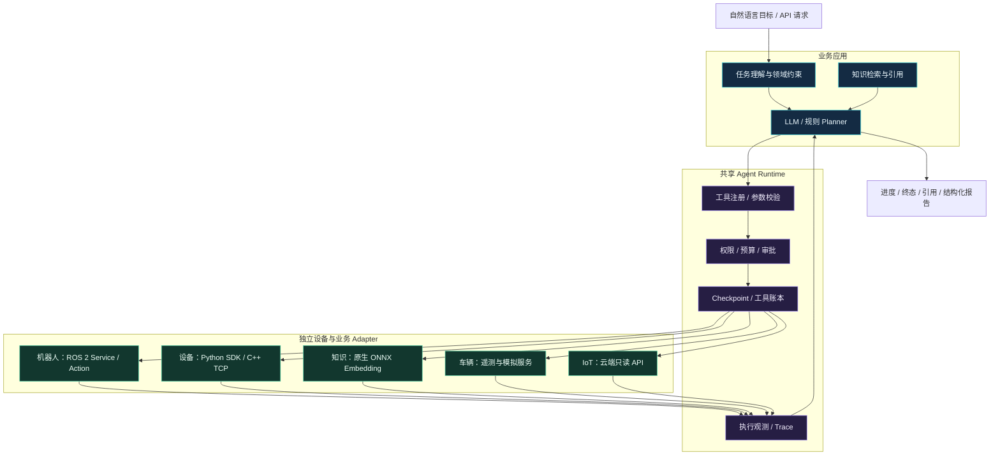
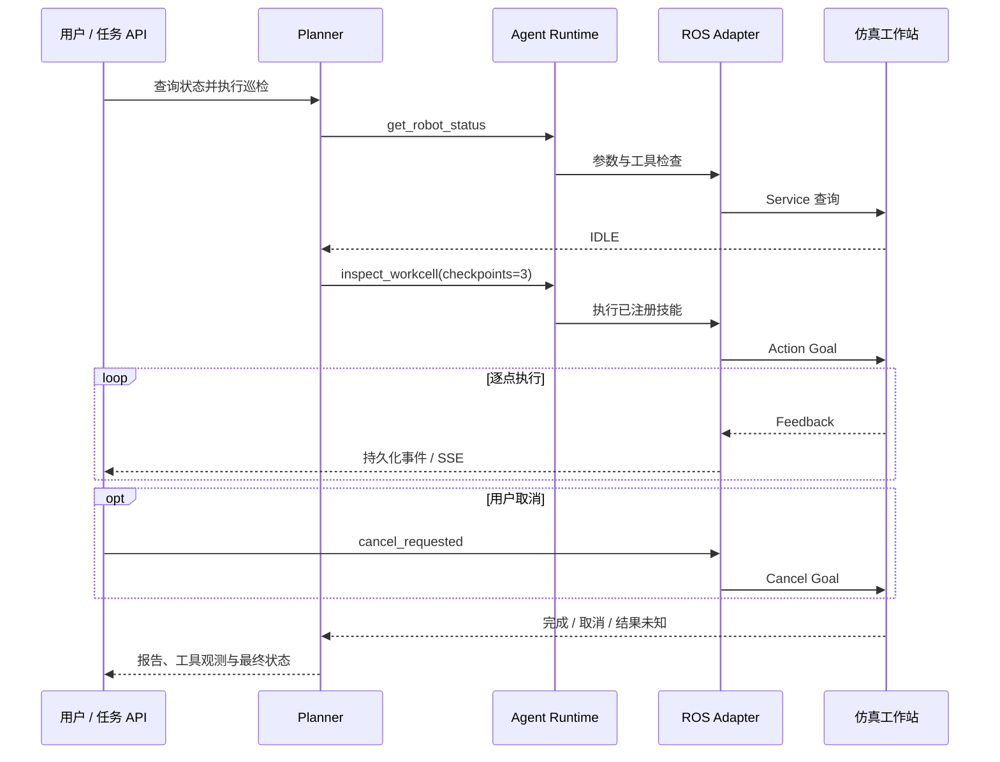
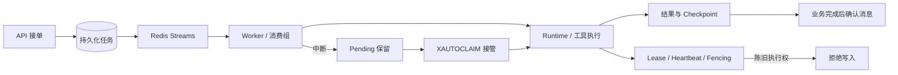

# 工业智能诊断与设备任务执行平台

**Python · FastAPI · LLM / RAG · Agent Runtime · PostgreSQL · Redis Streams · ROS 2**

[](https://github.com/KristenYue/telecom-network-incident-agent/actions/workflows/ci.yml)

[个人技术作品集](https://github.com/KristenYue) · [共享执行内核](https://github.com/KristenYue/agent-runtime-quality-platform) · [C++ 设备与模型 SDK](https://github.com/KristenYue/edge-device-verification-lab)

将自然语言目标转为**有设备观测、有执行约束、有进度反馈、有来源依据**的软件任务。

系统根据任务和已有观测选择工具，接入机器人技能、C++ 仿真设备、知识库及车辆服务，保存工具调用、执行状态、知识引用与最终结果。本仓库负责业务应用和设备 Adapter，通用执行机制复用独立 Agent Runtime。

---

## 按研发方向阅读

| 您关注的方向 | 从这里开始 | 重点看什么 |
|---|---|---|
| **具身智能 / 机器人 AI 应用、后端、任务平台** | [机器人技能与任务执行](docs/ROBOT_DELIVERY.md) | 模型规划、技能契约、ROS 2 Service / Action、反馈与取消、任务事件 |
| **半导体 / AI 芯片应用、模型 SDK、研发工具软件** | [原生模型与设备诊断轨迹](docs/evidence/native-llm-live.json) → [推理 SDK](https://github.com/KristenYue/edge-device-verification-lab/tree/main/inference_sdk) | 设备观测、原生 Embedding、知识引用、跨语言接口与应用集成 |
| **智能汽车 / 车载 Agent、智能终端与端云服务** | [车辆服务与 Agent 适配](docs/VEHICLE_ADAPTER.md) | 信号解释、知识查询、写操作审批、遥测新鲜度、幂等状态提交 |
| **应用后端 / 可靠任务平台** | [可靠任务设计](docs/RELIABLE_JOBS.md) → [执行内核](https://github.com/KristenYue/agent-runtime-quality-platform) | 持久化、消息回收、执行权、Checkpoint、重复投递与异常恢复 |

---

## 项目解决什么问题

设备状态查询、知识查询和控制接口往往彼此独立。研发人员需要自行判断调用顺序、关联结果，并在断连、超时或任务中断后确认动作到底执行到了哪里。

本项目将这些能力组织成可追踪的任务闭环：

| 场景 | 输入 | 系统处理 | 输出 |
|---|---|---|---|
| **机器人巡检** | 查询工作站并执行三点巡检 | 读取状态、检查前置条件、提交技能、接收反馈，支持中途取消 | 已完成检查点、执行终态、进度事件与报告 |
| **设备无法启动** | 分析设备启动失败原因 | 查询 C++ 设备状态，识别联锁，检索对应知识 | 故障解释、处置建议、设备观测和文档引用 |
| **车辆智能服务** | 解释胎压告警、调整模拟空调 | 读取信号与知识；控制操作经显式审批后执行 | 状态解释、审批记录、命令结果 |
| **通信故障诊断** | 告警、接口、邻居与链路指标 | 调用只读工具、关联运行手册、整理支持与反证 | 根因候选、依据与工单草稿 |

---

## 系统架构



**模型提出结构化动作，软件执行层决定动作是否允许执行。** 设备状态、工具参数、执行预算和审批要求由代码约束，设备端联锁独立生效。

### 模块责任边界

| 模块 | 主要职责 | 源码 |
|---|---|---|
| 工业模型 Planner | 模型服务调用、结构化动作、观测与知识依据检查 | [industrial_llm.py](src/telecom_incident_agent/industrial_llm.py) |
| 机器人任务服务 | 任务持久化、幂等提交、事件、取消与 Planner 约束 | [robot_tasks.py](src/telecom_incident_agent/robot_tasks.py) |
| 技能契约 | 参数、传输协议、逻辑工作站与技能接口 | [robot_skills.py](src/telecom_incident_agent/robot_skills.py) |
| ROS 2 Adapter | Service 查询、Action 执行、反馈、取消与终态映射 | [robot_ros.py](src/telecom_incident_agent/robot_ros.py) |
| 任务 API | 提交、查询、取消与 SSE 事件续读 | [robot_api.py](src/telecom_incident_agent/robot_api.py) |
| 工业知识工具 | 设备快照、知识检索与原生模型接入 | [industrial_diagnosis.py](src/telecom_incident_agent/industrial_diagnosis.py) |
| 车辆服务 | 遥测、知识、模拟控制、命令账本与状态事务 | [vehicle.py](src/telecom_incident_agent/vehicle.py) |
| 车辆模型 Planner | 工具选择、参数限制与服务端写许可 | [vehicle_llm.py](src/telecom_incident_agent/vehicle_llm.py) |
| 可靠任务 Worker | 消息消费、异常处理、Pending 回收与任务执行 | [worker.py](src/telecom_incident_agent/worker.py) |

机器人本地任务层采用 **SQLite + 单后台 Worker**。通信诊断部署路径采用 **PostgreSQL + Redis Streams**。两条业务路径复用 Runtime，部署与恢复语义分别记录。

---

## 核心设计一：模型决策如何成为受控执行

模型根据已有观测选择下一步工具，工具调用还需通过确定性的执行检查。

| 约束 | 实现机制 | 解决的问题 |
|---|---|---|
| **能力边界** | 显式工具注册与白名单 | 模型不能调用未开放的系统能力 |
| **参数边界** | Pydantic 参数契约、范围与字段校验 | 非法参数在接触设备前被拒绝 |
| **状态前提** | 巡检前必须取得新的 `IDLE` 观测 | 防止跳过设备状态检查 |
| **执行预算** | 限制查询、工具调用与重试次数 | 避免无效循环和反复执行 |
| **重试语义** | 只有显式 `retry_safe` 失败允许有限重试 | 不把未知副作用当作可安全重放 |
| **完成依据** | 完成报告必须基于实际工具结果 | 防止仅查询状态就宣称完成任务 |
| **控制授权** | 写工具先进入 `waiting_review` | 将模型建议与实际执行许可分离 |

---

## 核心设计二：长动作的进度、取消与未知结果

机器人巡检使用 ROS 2 Action 表达长时间执行，任务平台保存反馈和终态。



- **取消是请求**：记录取消意图，最终状态以执行器返回为准。
- **未知不是失败**：提交或结果超时保留 `result_unknown`，避免错误重试。
- **反馈可追踪**：进度进入事件库，查询接口和最终报告使用同一任务身份。
- **SSE 可续读**：按数据库事件 ID 获取后续事件，每批最多 100 条，不为每个订阅者维护独立内存队列。
- **中断有边界**：本地任务重启后遇到未完成动作，按未知结果处理，不自动重复执行非幂等技能。

---

## 核心设计三：重复投递与 Worker 中断后怎样恢复

通信诊断部署路径使用真实 PostgreSQL / Redis 服务验证可靠执行机制。



消息允许再次投递，通过任务身份、Checkpoint、工具账本和 Fencing 约束重复执行与结果提交。连续处理失败达到上限后转入死信。

**消息确认、业务结果落库和外部副作用分别处理。** 对无法确认执行结果的写工具，不通过盲目重试制造“成功”。

[可靠任务设计](docs/RELIABLE_JOBS.md) · [故障窗口](docs/DELIVERY_FAILURE_WINDOWS.md) · [共享 Runtime](https://github.com/KristenYue/agent-runtime-quality-platform)

---

## 机器人方向：模型规划与 ROS 2 技能接入

### 已运行结果

| 验收链路 | 实际结果 | 原始入口 |
|---|---|---|
| **真实模型 + 逻辑工作站** | **3 次模型决策、2 次工具调用**，执行三点巡检并保存报告 | [robot-live.json](docs/evidence/robot-live.json) |
| **规则 Planner + Linux ROS 2 + Runtime** | 状态查询返回 `IDLE`，**3/3 点巡检完成**，进度与终态持久化 | [云端验收](https://github.com/KristenYue/telecom-network-incident-agent/actions/runs/44509829892) |
| **同一 ROS Adapter 的取消分支** | 在 **1/3 点**请求取消，最终状态为 `canceled` | [云端验收及附件](https://github.com/KristenYue/telecom-network-incident-agent/actions/runs/44509829892) |
| **ROS 基础接口** | Topic、Service、8 点 Action 完成、逐点反馈与中途取消通过 | [接口与构建流程](.github/workflows/ci.yml) |

ROS 2 接口：

| 类型 | 接口 | 作用 |
|---|---|---|
| Topic | `/workcell/status` | 发布工作站状态 |
| Service | `/workcell/get_status` | 按需查询状态 |
| Action | `/workcell/inspect` | 提交巡检、接收反馈、请求取消 |

真实模型与 ROS 2 为两组独立验收：模型运行记录使用逻辑工作站，ROS 2 云端运行使用规则 Planner。两者共享技能契约与执行机制。

[机器人模块完整说明](docs/ROBOT_DELIVERY.md)

---

## 芯片与工业软件方向：设备观测与原生知识检索

### 业务闭环

> 分析设备无法启动的原因，依据设备观测和运行手册给出处置建议。

实际链路：

**真实 LLM → 设备状态工具 → C++ TCP 仿真设备 → 原生 ONNX 知识检索 → 结构化诊断。**

| 层次 | 完成的工作 |
|---|---|
| 设备观测 | Python SDK 查询 C++ 运行时，读取状态与联锁字段 |
| 原生模型 | Python 分词，C++ / ONNX Runtime 执行 BGE Embedding |
| 知识检索 | 关联设备知识，保留文档身份、版本与检索后端 |
| 模型结果 | 基于设备观测与知识内容生成故障解释、建议和证据 |
| 执行保护 | 设备联锁独立生效，不向模型开放绕过保护的能力 |

**联合运行结果：2 次工具调用，知识工具返回 `retrieval_backend=native_onnx`，最终状态为 `completed`。**

[原始联合轨迹](docs/evidence/native-llm-live.json) · [检索记录](docs/evidence/native-retrieval.json) · [原生推理 SDK](https://github.com/KristenYue/edge-device-verification-lab/tree/main/inference_sdk)

原生 SDK 另行完成预训练 BGE 输出对齐：`3×512` 输出最大绝对误差 **1.53×10⁻⁷**；Windows / Ubuntu Wheel 构建与干净环境安装通过。

版本化 Runbook 用于标识**结论采用了哪份知识、哪个版本**。检索负责获取依据，模型根据观测与知识生成结论，软件执行层约束实际动作。

---

## 智能汽车方向：信号解释、审批与状态一致性

| 模块 | 已完成工作 | 证据 |
|---|---|---|
| **车辆 Agent** | 真实模型解释胎压观测，调用项目知识，生成带来源的结果 | [vehicle-live.json](docs/evidence/vehicle-live.json) |
| **受控服务调用** | 模拟空调 22℃请求进入 `waiting_review`，演示显式批准后执行 | [模型与审批轨迹](docs/evidence/vehicle-live.json) |
| **信号接口** | 项目 DBC 子集解码车速、电量、车门和胎压；拒绝未知 ID、DLC 错误与越界值 | [vehicle-dbc.json](docs/evidence/vehicle-dbc.json) |
| **虚拟 CAN** | Linux `AF_CAN` / `vcan0` 实际收发，解出左前轮 **190 kPa** | [云端验收](https://github.com/KristenYue/telecom-network-incident-agent/actions/runs/44505903871) |
| **遥测一致性** | 依据采样时间判断新鲜度；迟到补传保存历史但不覆盖新状态 | [车辆服务源码](src/telecom_incident_agent/vehicle.py) |
| **控制一致性** | 仿真命令账本与状态同一事务提交；相同幂等键换参数拒绝 | [车辆服务源码](src/telecom_incident_agent/vehicle.py) |

车辆知识覆盖胎压、电量、车门、空调和数据新鲜度。220 kPa 为项目演示阈值；虚拟 CAN 与模拟服务均保留数据来源标记。

[车辆模块完整说明](docs/VEHICLE_ADAPTER.md)

---

## 运行方法

Python 3.11 / 3.12，在仓库根目录创建并激活虚拟环境：

```bash
python -m venv .venv

# Windows:
# .venv\Scripts\activate

# Linux:
# source .venv/bin/activate

python -m pip install -e '.[dev]'
```

### 无密钥运行

```bash
# 三点巡检
python scripts/demo_robot_agent.py --baseline --output .runtime/robot-completed.json

# 第一个检查点后取消
python scripts/demo_robot_agent.py --baseline --cancel-after 1 --output .runtime/robot-canceled.json

# 车辆诊断、审批与服务调用
python scripts/demo_vehicle.py --output .runtime/vehicle-baseline.json
```

### 真实模型运行

在本机环境变量中配置：

```text
TELECOM_MODEL_BASE_URL
TELECOM_MODEL_ID
TELECOM_MODEL_API_KEY
```

执行：

```bash
python scripts/demo_robot_agent.py --output .runtime/robot-live.json

python scripts/demo_vehicle.py --live-model --output .runtime/vehicle-live.json
```

密钥只通过环境变量读取，不写入公开运行结果。

### 启动机器人任务 API

```bash
robot-agent-api
```

默认监听本机 `127.0.0.1:8011`。接口实现见 [robot_api.py](src/telecom_incident_agent/robot_api.py)。

### 其他运行入口

- [ROS 2 工作空间、仿真节点与运行命令](docs/ROBOT_DELIVERY.md)
- [工业设备接入与模型运行](docs/INDUSTRIAL_AGENT.md)
- [车辆服务与信号解码](docs/VEHICLE_ADAPTER.md)
- [原生 SDK 构建与模型准备](https://github.com/KristenYue/edge-device-verification-lab/tree/main/inference_sdk)
- [PostgreSQL / Redis 可靠任务设计](docs/RELIABLE_JOBS.md)

---

## 工程复盘与 Bad Case

| 实际问题 | 处理方式 | 设计认识 |
|---|---|---|
| ROS Topic / Action 发现存在启动时序 | 指定 Topic 类型，等待服务就绪，配置发现期限并保留启动日志 | 节点进程启动不等于通信接口已就绪 |
| 自定义 ROS Context 与默认 Executor 错配 | Executor 显式绑定同一 Context，统一销毁顺序 | 生命周期和执行上下文必须保持一致 |
| 取消与完成并发发生 | 保存取消请求，以 Action 返回决定终态 | 请求取消不代表动作已经撤销 |
| 工具结果未知时再次执行 | 保留 `result_unknown`，只允许明确安全的重试 | 超时不能直接解释为未执行 |
| 旧遥测恢复后晚到 | 以采样时间判断当前状态，接收时间单独保存 | 最新收到不等于最新采样 |
| Worker 失效后旧执行者恢复 | 使用租约代际与 Fencing 拒绝陈旧写入 | 存活检测和写权限约束是两个问题 |

---

## 源码与证据索引

| 想核查什么 | 入口 |
|---|---|
| 全部新增模块与运行结果 | [EVIDENCE_INDEX.md](docs/EVIDENCE_INDEX.md) |
| 系统架构 | [ARCHITECTURE.md](docs/ARCHITECTURE.md) |
| 机器人任务、反馈与取消 | [ROBOT_DELIVERY.md](docs/ROBOT_DELIVERY.md) |
| 原生模型与设备联合诊断 | [native-llm-live.json](docs/evidence/native-llm-live.json) |
| 车辆服务与模型轨迹 | [VEHICLE_ADAPTER.md](docs/VEHICLE_ADAPTER.md) |
| 消息回收与任务恢复 | [RELIABLE_JOBS.md](docs/RELIABLE_JOBS.md) |
| 通信诊断实验 | [EVIDENCE_CARD.md](docs/EVIDENCE_CARD.md) |
| 工程失败案例 | [BAD_CASES.md](docs/BAD_CASES.md) |

<details>
<summary>执行环境与结果口径</summary>

- 机器人为 ROS 2 逻辑工作站，设备为 C++ 软件仿真；车辆使用合成服务与虚拟 CAN。
- 原生模型执行使用 ONNX Runtime CPU，模型与设备联合轨迹为真实运行记录。
- 机器人真实模型和 ROS 2 分别验收，不合并描述为联合模型驱动 ROS 2 已完成。
- PostgreSQL / Redis 验收属于对应业务部署路径；机器人本地任务层采用 SQLite 单 Worker。
- SSE 已验证端点契约与事件续读，不作为 HTTP 并发压测或生产容量结论。
- 版本化知识引用、工具白名单和演示审批具有明确代码边界，不等同于企业完整身份权限系统。
- 通信故障数据来自项目自建场景，实验结果不外推为运营商生产效果或 SLA。

</details>

---

[MIT License](LICENSE)
