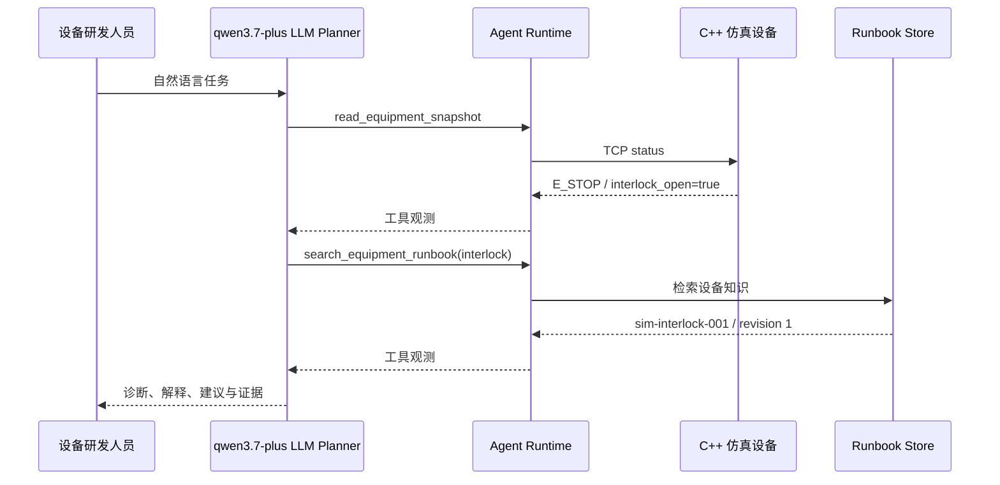
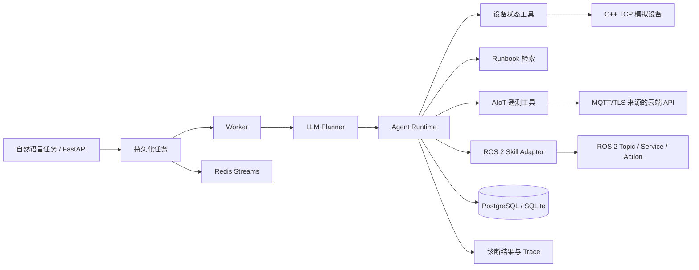

# Industrial AI Agent — 工业智能诊断与设备任务执行平台

[](https://github.com/KristenYue/telecom-network-incident-agent/actions/workflows/ci.yml)

## Project Overview

面向设备研发与智能系统集成的工业 AI 应用。研发人员可以直接提出自然语言任务，真实 LLM 根据当前任务和工具观测选择设备状态、知识检索等能力，Agent Runtime 执行调用并保存上下文，最终输出诊断结论、技术解释、处置建议和证据引用。

项目把 AI 应用连接到三类系统接口：

- **TCP / C++ 设备运行时：** 查询状态、识别安全联锁、提交显式授权的仿真任务。
- **MQTT 来源的 AIoT 遥测：** 通过云端只读 API 获取智能货架最新状态。
- **ROS 2 仿真工作站：** 使用 Topic、Service 和 Action 查询状态、执行巡检、反馈进度和取消任务。

通信故障诊断能力继续作为领域扩展保留，但项目的首要定位是 **Industrial AI Applications & Intelligent Systems**。

## Application Scenarios

| 场景 | 用户目标 | Agent 行为 | 业务输出 |
|---|---|---|---|
| 设备无法启动 | “分析设备 A 为什么无法启动” | LLM 查询设备状态，识别联锁，检索对应 Runbook | 故障原因、技术解释、安全建议、设备与知识证据 |
| AIoT 状态诊断 | 查询货架低库存或遥测异常 | 读取带设备身份和接收时间的云端遥测，检索设备知识 | 库存/告警结论与人工核查建议 |
| 仿真巡检 | 执行工作站巡检并反馈进度 | 调用 ROS 2 Action，持续接收反馈，按条件取消 | 完成/取消状态、已完成巡检点和 Runtime Trace |
| 通信故障研判 | 分析告警、接口、路由与指标 | 并发调用只读工具，检索通信 Runbook，生成工单草稿 | 根因候选、反证、引用和人工审批状态 |

## Features & Real Demonstration

### 真实 LLM 工具调用闭环

**用户输入**

```text
帮我分析设备 A 为什么无法启动，并提供故障原因和下一步处理建议。
```

**实际执行链**



2026-11-18 本机真实联调结果：

| 证据 | 实际结果 |
|---|---|
| 模型 | `qwen3.7-plus-2026-05-26`，OpenAI-compatible HTTPS 服务 |
| 模型决策 | 3 次：状态工具、知识工具、最终结构化结论 |
| Runtime 工具调用 | 2 次：`read_equipment_snapshot`、`search_equipment_runbook` |
| 设备观测 | C++ TCP 模拟器返回 `E_STOP` |
| 知识引用 | `sim-interlock-001`，revision `1` |
| 最终状态 | `completed`，`agent_mode=model_driven` |
| 凭据 | `credentials_recorded=false` |

[查看脱敏原始轨迹](docs/industrial-agent-live.json) · [查看模型 Planner 源码](src/telecom_incident_agent/industrial_llm.py) · [查看验收脚本](scripts/demo_industrial_llm_agent.py)

最终结果包含：

```json
{
  "diagnosis": {
    "fault": "interlock",
    "summary": "设备处于安全联锁状态，控制层拒绝启动。"
  },
  "recommendation": {
    "next_step": "由授权人员检查急停按钮与安全门/联锁传感器。",
    "safety_boundary": "严禁远程强制覆盖联锁信号。"
  },
  "evidence": [
    {"source": "device_status", "state": "E_STOP"},
    {"source": "runbook", "runbook_id": "sim-interlock-001", "revision": "1"}
  ]
}
```

### Robot Skill Adapter

`ros2/industrial_robot_sim` 提供：

- Topic `/workcell/status`：发布 `IDLE` / `INSPECTING`；
- Service `/workcell/get_status`：按需读取状态；
- Action `/workcell/inspect`：执行 8 个巡检点、反馈进度并支持取消；
- `scripts/demo_ros_runtime.py`：将 Action 封装为 Runtime 工具并保存调用轨迹。

源码和命令可永久复现；[CI 记录](https://github.com/KristenYue/telecom-network-incident-agent/actions/runs/44054439447)补充证明状态查询、8 点完成、进度反馈与中途取消曾在托管 ROS 2 环境执行。

## System Architecture



模型只负责提出结构化动作；Runtime 决定工具是否注册、参数是否满足约束、预算是否足够以及是否需要人工确认。C++ 设备控制层独立执行安全联锁，模型不能绕过设备端保护。

## Core Implementation

| 模块 | 实现 |
|---|---|
| LLM Planner | OpenAI-compatible JSON action；兼容扁平/嵌套工具格式；本地校验顺序、故障类别和证据完整性 |
| 工业工具 | 设备快照、版本化 Runbook、AIoT 遥测；工具结果进入统一 Trace |
| 设备任务 | FastAPI 接单、SQLite/PostgreSQL 持久化、单执行者领取、租约过期后结果未知处理 |
| C++ 接口 | Python SDK 经 TCP JSON Lines 调用仿真设备状态和显式授权任务 |
| ROS 2 接口 | Topic / Service / Action + Runtime 工具封装 |
| 长任务执行 | Redis Streams、Checkpoint、Lease、Fencing、幂等结果和人工审批 |
| 结果生成 | 结构化任务理解、诊断、技术解释、建议、安全边界和证据列表 |

模型防护不是仅靠 Prompt：若模型跳过设备观测、选择与状态不一致的故障、提前结束或调用未注册工具，Runtime 会失败关闭。

## Engineering Results

| 结果 | 工程含义 | 永久证据 |
|---|---|---|
| 真实模型 3 次规划 + 2 次工具调用 | LLM 实际参与任务理解和工具选择，不是报告润色器 | [live trace](docs/industrial-agent-live.json) |
| C++ 设备 `RUN_COMPLETE` / `SAFETY_INTERLOCK` / 离线分支 | 同一任务接口覆盖正常执行、设备保护和通信失败 | [device API trace](docs/device-api-smoke.jsonl) |
| ROS 2 8 点巡检、进度与取消 | Agent 工具可扩展到长时间机器人技能 | [ROS 2 source](ros2/industrial_robot_sim) |
| PostgreSQL 接管 + Redis Pending 回收 | AI 长任务可在 Worker 中断后继续处理 | [reliable jobs](docs/RELIABLE_JOBS.md) |
| 12 类通信故障与 9 个受控工具 | 同一 Runtime 可适配另一类工业/通信知识任务 | [architecture](docs/ARCHITECTURE.md) |

## Industry Applications

- **半导体与 AI 芯片：** 设备状态分析、研发知识助手、日志诊断、研发工具 Agent。当前证据来自 C++ 仿真设备，不代表真实半导体产线接入。
- **智能汽车：** 车端/云端状态工具、智能场景执行、智驾研发辅助接口。当前未接入真实车辆、CAN 总线或量产智驾系统。
- **具身智能：** 机器人 Agent、技能编排、状态查询和 ROS 2 Action 调用。当前为仿真工作站，不包含导航、运动控制或真机部署。

## Quick Start

Python 3.11 或 3.12：

```powershell
python -m venv .venv
.\.venv\Scripts\python.exe -m pip install -e ".[dev]"
.\.venv\Scripts\python.exe -m pytest -q --basetemp .pytest-tmp
```

运行无密钥通信诊断演示：

```powershell
.\.venv\Scripts\python.exe -m telecom_incident_agent.demo
```

启动 API：

```powershell
$env:TELECOM_SIMULATOR_PORT = "18765"
.\.venv\Scripts\python.exe -m uvicorn telecom_incident_agent.api:app --host 127.0.0.1 --port 8000
```

自然语言工业 Agent 请求：

```json
POST /v1/device-tasks
{
  "scenario": "agent",
  "request": "帮我分析设备 A 为什么无法启动，并提供故障原因和下一步处理建议。"
}
```

真实模型 + C++ 模拟器验收：

```powershell
$env:TELECOM_MODEL_BASE_URL = "https://<openai-compatible-endpoint>/v1"
$env:TELECOM_MODEL_ID = "<model-id>"
.\.venv\Scripts\python.exe scripts\demo_industrial_llm_agent.py --prepare-interlock
```

脚本使用密码遮罩临时输入 API Key，不将凭据保存到文件。完整设备、AIoT 和 ROS 2 命令见 [Industrial Agent guide](docs/INDUSTRIAL_AGENT.md)。

## Evidence & Source Code

| 内容 | 入口 |
|---|---|
| 真实模型与工具轨迹 | [docs/industrial-agent-live.json](docs/industrial-agent-live.json) |
| LLM Planner | [industrial_llm.py](src/telecom_incident_agent/industrial_llm.py) |
| 工业诊断工具与知识 | [industrial_diagnosis.py](src/telecom_incident_agent/industrial_diagnosis.py) |
| 设备任务执行 | [device_tasks.py](src/telecom_incident_agent/device_tasks.py) |
| ROS 2 Skill Adapter | [ros2/industrial_robot_sim](ros2/industrial_robot_sim) |
| 可靠任务与故障窗口 | [RELIABLE_JOBS.md](docs/RELIABLE_JOBS.md) · [DELIVERY_FAILURE_WINDOWS.md](docs/DELIVERY_FAILURE_WINDOWS.md) |
| 通信诊断评测与证据 | [EVIDENCE_CARD.md](docs/EVIDENCE_CARD.md) · [CLAIMS_AND_EVIDENCE.md](docs/CLAIMS_AND_EVIDENCE.md) |

## Validation & Limitations

- 真实 LLM 调用已完成，但设备是本机 C++ 仿真运行时，不是真实工业设备。
- AIoT Agent 读取接口使用既有云端 API 契约；当前自动回归使用合成云端响应，不声称完成持续在线的真实 AWS 联调。
- ROS 2 证据来自仿真工作站和托管 CI，不代表移动机器人、人形机器人或真实运动控制。
- 通信诊断的 `telecom-synthetic-v2` 包含 100 条封存输入；48 条越权请求、40 条注入场景、14 类故障注入及 RAG 指标均来自项目自建合成数据，只验证当前工程契约。
- V2 另有 240 条 development 输入用于开发调试，不进入封存结论；工具白名单不是**身份认证或 RBAC**。不要把这些合成离线结果表述为运营商生产效果、真实网络泛化能力或 SLA。
- PostgreSQL、Redis 和 Compose 记录证明链路可运行，不代表生产容量、SLA 或 exactly-once 外部副作用。
- 设备写操作与诊断工具分离；项目不执行真实设备重启、接口关闭、路由修改或配置下发。

详细测试数量、质量门禁、Bad Case 和数据边界已移至 [Evidence Card](docs/EVIDENCE_CARD.md)、[Bad Cases](docs/BAD_CASES.md)、[Data Card](docs/DATA_CARD.md) 与 [Known Limitations](docs/KNOWN_LIMITATIONS.md)。

## License

[MIT](LICENSE)
