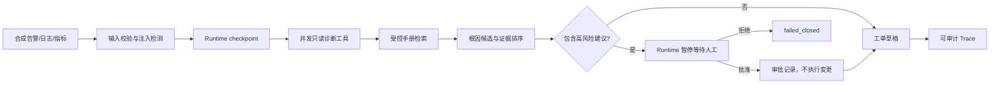

# 通信网络故障诊断 Agent

[](https://github.com/KristenYue/telecom-network-incident-agent/actions/workflows/ci.yml)

> 从告警、指标和日志中生成可审计根因候选，并把异步执行、人工审批、故障恢复和质量门禁放进同一条工程链路。

系统以 FastAPI 接收故障任务，通过 Redis Streams 分发给异步 Worker，在 PostgreSQL 中保存任务、审批和 Runtime 状态；共享 **Agent Runtime & Evaluation Platform** 提供 checkpoint、lease、fencing、幂等账本与统一 Trace，通信层负责领域工具、根因排序和工单草稿。

## Evaluation scorecard

| 冻结证据 | 结果 | 失败边界 |
|---|---:|---|
| 诊断封存集 | **100 条；Top-1 / Top-3 = 100% / 100%** | 只说明确定性策略与自编标签一致 |
| 未注册工具请求 | **48 / 48 拒绝；执行数 0** | 工具白名单，不等同于完整身份认证 |
| Prompt Injection | **40 / 40 拦截** | 37 条输入层拒绝 + 3 条权限层阻断 |
| PostgreSQL 接管 | **真实 CI 服务验证** | 过期 lease 接管，陈旧 fencing token 写入失败 |
| 高风险动作 | **全部停在人工审批** | 批准后也只创建工单草稿，不操作设备 |

## Engineering surface

| 范围 | 实现 |
|---|---|
| 诊断与评测 | 12 类故障策略；60 条 V1 冻结任务；V2 包含 240 条开发输入、100 条封存输入与独立安全 cohort |
| 工具与 Runtime | 9 个受控工具；证据优先 Planner；checkpoint、lease、fencing、Trace 与幂等键 |
| 安全与审批 | Prompt Injection 检测、凭据脱敏、设备/接口白名单；高风险建议进入 `waiting_review`，批准后也只生成工单草稿 |
| 数据与门禁 | 版本化 JSONL、SHA-256 manifest、14 类故障注入结果与成对发布门禁 |
| 服务与观测 | HTTP API、Redis Streams 确认/重投/死信、SQLite/PostgreSQL、Trace UI、Prometheus、Grafana 与六服务 Compose |

## 可复现结果

`telecom-synthetic-v1` 的 60 条确定性合成契约任务当前结果：

| 指标 | 结果 |
|---|---:|
| Top-1 根因准确率 | 100% |
| Top-3 根因召回率 | 100% |
| 证据覆盖率 | 100% |
| 审批策略正确率 | 100% |
| Prompt Injection 拒绝率 | 100% |
| 合成手册 Recall@5 / MRR@5 / nDCG@5 | 100% / 100% / 100% |
| Runtime 成对门禁 | 通过（60 对） |

这些数字只说明代码对**自己冻结的合成契约**满足预期，不代表真实网络泛化、生产 SLA 或运营商部署效果。简单 alarm lookup baseline 和 Runtime candidate 使用同一套五维质量口径；candidate 的优势来自证据、注入拒绝和审批策略，而不是把不同口径的分数硬比较。

### V2：封存输入与安全 cohort

V2 将开发输入与评测输入分离：240 条 development 输入不参与最终报告，100 条
`telecom-synthetic-v2` 输入经 LF 规范化 SHA-256 封存后再运行评测。当前封存输入哈希为
`41df471d0a064582f37a614c3e5d39b1f9d345454be4c3252ff1c7edf0979b42`。

| 证据 | 当前离线合成结果 | 解释边界 |
|---|---:|---|
| 100 条封存输入 Top-1 / Top-3 | 100% / 100% | 确定性规则与项目自编标签的一致性 |
| 证据覆盖 / 审批策略 | 100% / 100% | 仅本地合成工具和草稿流程 |
| 嵌入式注入样本 | 12/12 清洗并标记 | 包含在冻结诊断输入内 |
| 独立未注册工具 cohort | 48/48 拒绝，执行数 0 | 工具白名单；**不是**身份认证或 RBAC |
| 独立注入 cohort | 40/40 拦截：37 条输入层显式拒绝，3 条工具权限层拦截 | 合成双层防护演练；非生产安全验证 |
| 鲁棒性挑战集 | 4/4 通过 | 固定别名、人工升级、双故障、畸形输入 |

完整的输入 manifest、机器可读报告和已知限制见
[证据索引](docs/EVIDENCE_CARD.md) 与
[主张与证据边界](docs/CLAIMS_AND_EVIDENCE.md)。不要把这些合成离线结果表述为运营商
生产效果、SLA 或泛化准确率。

## 工作流



## 可靠异步任务链

```text
FastAPI -> Redis Stream -> consumer group -> Runtime Worker
                          | success -> XACK + delete
                          | failure -> pending entry
                          | worker crash -> visibility timeout -> XAUTOCLAIM
                          | delivery limit -> dead-letter stream
```

Worker 只有在 PostgreSQL 结果保存完成后才确认 Stream 消息。进程在取到任务后退出时，消息仍保留在 pending-entry list，其他 Worker 可在可见性超时后接管；连续失败超过阈值则进入死信 Stream，并保留原消息、投递次数和最后错误。Runtime 的 fencing token 同时阻止失租旧 Worker 回写 checkpoint。

## Findings → fixes → regression evidence

| 发现的问题 | 根因 | 解决方式 | 防回归证据 |
|---|---|---|---|
| 下游告警数量压过真正根因 | 早期排序把症状频次当作因果强度 | 按故障策略要求关键观测与反证，再计算候选分 | 混淆故障与双故障挑战集 |
| 注入字符串可能绕过单点检测 | 仅靠输入关键词无法覆盖工具层攻击 | 输入检测与工具 allowlist 分层防护 | 37 条显式拒绝 + 3 条权限层阻断 |
| 未注册工具异常泄漏为普通 `ValueError` | Runtime 边界没有统一安全语义 | 归一化为 `tool_not_allowed` 并失败关闭 | 48 条越权 cohort，实际执行数 0 |
| Worker lease 过期后旧实例可能继续写 | 缺少单调执行代际 | PostgreSQL lease takeover + fencing token | 真实 PostgreSQL 双 Worker CI 测试 |
| 高风险建议容易被误解为已执行 | 诊断结论与副作用动作边界不清 | 只生成审批记录和工单草稿 | Trace 断言无设备变更工具 |

## 快速开始

Python 3.11 或 3.12：

```powershell
python -m venv .venv
.\.venv\Scripts\python.exe -m pip install -e ".[dev]"
.\.venv\Scripts\python.exe -m pytest -q --basetemp .pytest-tmp
```

运行无密钥演示：

```powershell
.\.venv\Scripts\python.exe -m telecom_incident_agent.demo
```

启动 API：

```powershell
.\.venv\Scripts\python.exe -m uvicorn telecom_incident_agent.api:app --host 127.0.0.1 --port 8000
```

打开 `http://127.0.0.1:8000/docs` 查看 OpenAPI。接口为：

- `POST /v1/incidents`
- `GET /v1/incidents/{incident_id}`
- `GET /v1/incidents/{incident_id}/trace`
- `POST /v1/incidents/{incident_id}/reviews`
- `POST /v1/incidents/{incident_id}/resume`
- `GET /v1/runbooks/search`

完整 C4 合成环境可一键启动：

```powershell
docker compose up --build
```

启动后：

- API/OpenAPI：`http://127.0.0.1:8000/docs`
- Trace 页面：`http://127.0.0.1:8000/trace-ui`
- Prometheus：`http://127.0.0.1:9090`
- Grafana：`http://127.0.0.1:3000`（本地默认账号见 Compose，可通过环境变量覆盖）

部署模式下 `POST /v1/incidents` 先返回 `queued`，Redis Worker 随后执行诊断。未设置 `TELECOM_DATABASE_URL` 和 `TELECOM_REDIS_URL` 时，仍保留 SQLite 单进程直跑模式用于开发和离线演示。

重新生成和评测冻结任务：

```powershell
.\.venv\Scripts\python.exe scripts\generate_dataset.py
.\.venv\Scripts\python.exe scripts\evaluate.py
```

重新运行 V2 封存报告与安全/鲁棒性验证：

```powershell
.\.venv\Scripts\python.exe scripts\evaluate_v2_frozen.py
.\.venv\Scripts\python.exe scripts\evaluate_v2_security_cohorts.py
.\.venv\Scripts\python.exe scripts\evaluate_robustness.py
```

## 关键目录

```text
src/telecom_incident_agent/   领域契约、工具、Planner、Runtime adapter、API、Worker
deploy/                       PostgreSQL、Prometheus、Grafana 配置
data/evaluation/              60 条冻结任务、manifest 和评测报告
examples/                     可审计的暂停/批准/恢复 Trace 示例
tests/                        契约、安全、Runtime、审批、API 与完整评测测试
docs/                         架构、数据卡、权限、状态机、工程日志和演示稿
scripts/                      数据生成与离线评测入口
```

## 明确边界

- 不使用来源不明的企业日志；
- 不声称接入中国电信或任何运营商生产系统；
- 不拥有真实网管权限；
- 不执行接口重启、路由修改、设备重启等操作；
- 不把合成数据上的 100% 当作真实网络准确率；
- SQLite 是本地离线验证路径；PostgreSQL/Redis/监控拓扑由托管 Linux CI 验证，不据此承诺生产容量或 SLA。

完整设计见 [架构](docs/ARCHITECTURE.md)、[可靠任务设计](docs/RELIABLE_JOBS.md)、[数据卡](docs/DATA_CARD.md)、[工具与权限](docs/TOOLS_AND_PERMISSIONS.md)、[故障状态机](docs/FAILURE_STATE_MACHINE.md)、[工程日志](docs/ENGINEERING_LOG.md)、[Bad Cases](docs/BAD_CASES.md)、[证据索引](docs/EVIDENCE_CARD.md) 和 [计划完成度核对](docs/PLAN_COMPLETENESS.md)。

## License

[MIT](LICENSE)
