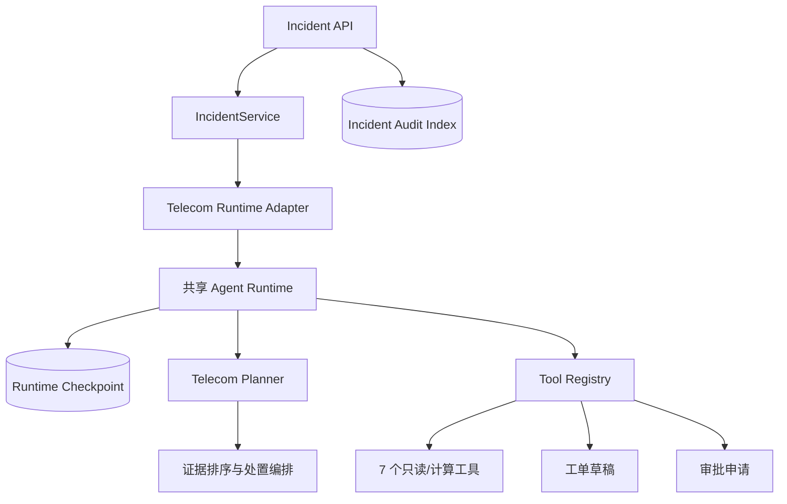

# 架构与复用边界

## 原则

通信项目只实现领域适配，不复制 Runtime。`TelecomIncidentRuntimeAdapter` 将 `IncidentRequest` 序列化为 Runtime request，注册通信工具并把 Runtime Trace 转换为诊断结果和工单草稿。

共享 Runtime 负责 Planner Protocol、工具批次、预算、checkpoint、pause/resume、lease、fencing、幂等结果账本和统一 Trace。通信代码负责领域契约、权限映射、合成 fixture、根因排序和工单输出。

## 当前状态

- C0：完成。12 类故障和边界已冻结。
- C1：完成。9 个工具、完整诊断链路、工单草稿和无密钥 Demo 已实现。
- C2：主体完成。本地 checkpoint、审批恢复和 Trace 已接入；真实 PostgreSQL 双 Worker 证据复用 Runtime 仓库，但本项目尚未完成独立 Compose 集成验收。
- C3：第一版完成。60 条任务、注入/审批安全场景、成对门禁已固化；RAG 指标当前基于 12 份小型合成手册。
- C4：未完成。完整 PostgreSQL/Redis Worker、Prometheus/Grafana、Trace 页面与 Docker Compose 仍待实现和实机验收。

## Windows 开发宿主边界

当前托管 Windows 沙箱无法结束最小 `asyncio.run()`、timer 和 `to_thread()`。适配器因此只在 `sys.platform == "win32"` 的合成离线模式使用直接 SQLite backend、顺序工具批次和无 heartbeat 的短租约兼容层；它仍保留 checkpoint、fencing 与幂等写入。Linux 和正式部署使用共享 Runtime 原实现。这个兼容层不是生产恢复证据。
