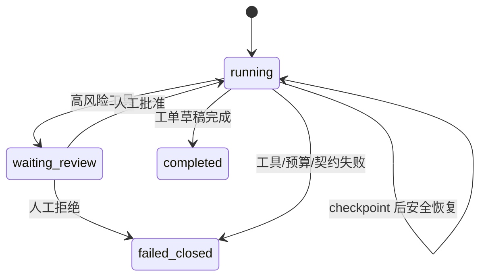

# 故障状态机

当前映射：

- 工具连接、超时、无效响应：`failed_closed` 并保留错误 Trace。
- Prompt Injection：删除指令性内容、记录安全标志；仍只依据独立证据诊断。
- 高风险请求：`waiting_review`。
- 人工拒绝：`failed_closed / human_rejected`。
- 人工批准：只生成审批记录和草稿，然后恢复。
- 工具调用预算耗尽：`failed_closed / tool_budget_exceeded`。
- 证据不足：领域结果 `manual_required`，不得给出确定性根因。

`retrying`、跨 Worker lease 接管和 PostgreSQL checkpoint 故障注入属于下一阶段的独立集成验收，当前项目不伪造已完成证据。
