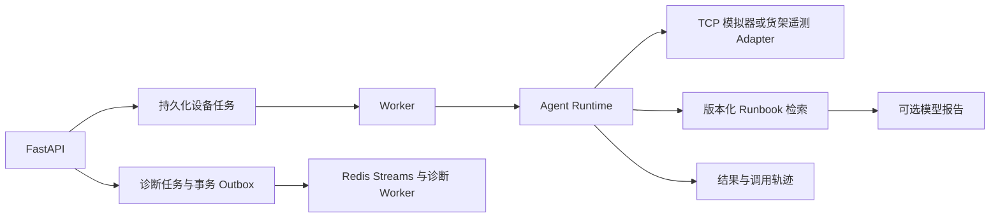

# 工业设备诊断与任务编排

设备研发人员可以通过一个任务接口读取状态、查询来源明确的运维知识，或为仿真设备提交显式授权的操作。原通信诊断 API 继续使用原有通信告警、指标和网络 Runbook。

| 数据路径 | 任务 | 工程证据 |
| --- | --- | --- |
| C++ 模拟设备 → TCP | `diagnose`、`run`、`interlock` | 真实本机 HTTP/SQLite/TCP 联调，轨迹含设备请求 ID、状态、诊断类别与知识条目版本 |
| 货架 MQTT/TLS → AWS IoT → 云端读 API | `diagnose_shelf` | 使用原有遥测接口，验证身份、接收时间、状态取值及过期回退。当前回归使用合成云端响应 |
| ROS 2 仿真工作站 → Action | 独立 `demo_ros_runtime.py` | 源码和接口已写入工作区，本机已做 Python 语法检查，ROS 2 构建与运行待验证 |

## 复现与工程决策



核心模块为 [API](../src/telecom_incident_agent/api.py)、[设备任务](../src/telecom_incident_agent/device_tasks.py)、[诊断编排](../src/telecom_incident_agent/industrial_diagnosis.py)、[Outbox 存储](../src/telecom_incident_agent/repository.py) 和 [Worker](../src/telecom_incident_agent/worker.py)。

面试准备：说明 Redis XADD 成功后 Outbox 删除失败的恢复过程、任务结果落库后才能 ACK 的原因、设备写命令在结果未知时为何不自动重放，以及模型输出为什么只作为报告。

### 真实模型验收

仿真设备分支可选调用 HTTPS 模型服务。模型只接收模拟设备快照与检索出的 Runbook，生成可审阅报告。工具轨迹保留调用结果，报告不会执行设备命令。服务不可用时保留确定性诊断并记录 `model_report.status=unavailable`。

先按 [设备任务启动说明](DELIVERY_FAILURE_WINDOWS.md) 运行模拟器，再在本仓库已有虚拟环境执行以下命令。脚本会隐藏输入密钥。模型结果应显示三次工具调用，并保存报告引用的版本化知识条目。

```powershell
$env:TELECOM_MODEL_BASE_URL = $env:FSO_MODEL_BASE_URL
$env:TELECOM_MODEL_ID = $env:FSO_MODEL_ID
.\.venv\Scripts\python.exe scripts/verify_model_report.py --port 18765
```

当前模型分支的三步调用只通过了替身响应回归，服务端真实调用待密钥环境验收。SQLite 轨迹是本机联调证据。PostgreSQL/Redis 分布式部署通过仓库 Compose、独立 takeover 和 Redis reliability 工作流复现，发布版本的结论以对应提交运行状态为准。

沿用 [设备任务启动说明](DELIVERY_FAILURE_WINDOWS.md)，运行 `scripts/smoke_device_api.py`。急停后诊断引用 `sim-interlock-001`，关闭模拟器后诊断引用 `sim-transport-001`。确定性 Agent Planner 调用白名单只读工具。通信和设备场景共用词项检索与故障过滤，维护各自的知识条目版本。设备动作需要独立提交和双重显式授权。原始结果见 [API 轨迹](device-api-smoke.jsonl)。

货架接入通过 `TELECOM_SHELF_SOURCE_URL`、`TELECOM_SHELF_DEVICE_ID`、可选 `TELECOM_SHELF_SOURCE_TOKEN` 配置。启用任务 API 后提交 `{"scenario":"diagnose_shelf"}`，Worker 向既有 `GET /api/shelves/{deviceId}/telemetry?limit=1` 取最新一条。Token 只用于配置的上游，HTTP 只允许回环地址，禁止跟随重定向。旧遥测不会被解释为当前设备故障，返回遥测不可用并保留对应代码。两个设备诊断适配路径共用 Runtime、工具注册和结果持久化。

## ROS 2 可选演示

需要兼容当前 ROS 2 发行版的系统 Python、colcon 和本项目依赖。建议在 Ubuntu / ROS 2 Jazzy 下从仓库根目录执行：

```bash
source /opt/ros/jazzy/setup.bash
colcon build --base-paths ros2
source install/setup.bash
ros2 run industrial_robot_sim workcell_sim
```

另开同样加载环境的终端，查看 Topic 和调用 Service，再执行 Runtime Action 演示：

```bash
ros2 topic echo /workcell/status
ros2 service call /workcell/get_status std_srvs/srv/Trigger '{}'
python scripts/demo_ros_runtime.py --allow-simulation --checkpoint .runtime/ros-sim.sqlite3
python scripts/demo_ros_runtime.py --allow-simulation --cancel-after 3 --checkpoint .runtime/ros-sim.sqlite3
```

该节点模拟巡检点计数，返回进度并接受取消，仅允许一个活动任务。运行结果和取消均需在 ROS 环境验证后才能作为公开成果。当前没有模型部署、机器人运动控制或真实半导体产线测试数据。
