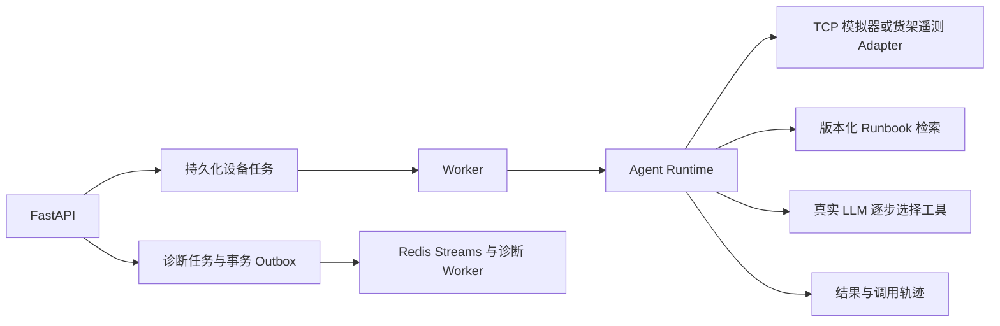

# 工业设备诊断与任务编排

设备研发人员可以通过一个任务接口读取状态、查询来源明确的运维知识，或为仿真设备提交显式授权的操作。原通信诊断 API 继续使用原有通信告警、指标和网络 Runbook。

| 数据路径 | 任务 | 工程证据 |
| --- | --- | --- |
| C++ 模拟设备 → TCP | `diagnose`、`run`、`interlock` | 真实本机 HTTP/SQLite/TCP 联调，轨迹含设备请求 ID、状态、诊断类别与知识条目版本 |
| 货架 MQTT/TLS → AWS IoT → 云端读 API | `diagnose_shelf` | 使用原有遥测接口，验证身份、接收时间、状态取值及过期回退。当前回归使用合成云端响应 |
| ROS 2 仿真工作站 → Action | 独立 `demo_ros_runtime.py` | 源码和接口已写入工作区，本机已做 Python 语法检查，ROS 2 构建与运行待验证 |

## 复现与工程决策



核心模块为 [API](../src/telecom_incident_agent/api.py)、[设备任务](../src/telecom_incident_agent/device_tasks.py)、[诊断编排](../src/telecom_incident_agent/industrial_diagnosis.py)、[Outbox 存储](../src/telecom_incident_agent/repository.py) 和 [Worker](../src/telecom_incident_agent/worker.py)。

面试准备：说明 Redis XADD 成功后 Outbox 删除失败的恢复过程、任务结果落库后才能 ACK 的原因、设备写命令在结果未知时为何不自动重放，以及模型输出为什么只作为报告。

### 真实 LLM 规划与工具调用验收

`scenario=agent` 接收自然语言请求，由 OpenAI-compatible HTTPS 模型逐轮规划。第一轮模型选择设备状态工具；Runtime 经 TCP 读取 C++ 模拟器。第二轮模型根据状态选择 Runbook 检索；第三轮模型提交结构化任务理解、诊断解释与处置建议。Runtime 本地校验工具顺序、故障参数与证据完整性，模型不能调用未注册工具，也不能在缺少状态或 Runbook 时提前生成结论。

先按 [设备任务启动说明](DELIVERY_FAILURE_WINDOWS.md) 运行模拟器，再执行以下命令。密钥只存在于当前进程环境，不写入轨迹。`--prepare-interlock` 仅用于把仿真设备布置到联锁场景，不属于 Agent 自动处置动作。

```powershell
$env:TELECOM_MODEL_BASE_URL = "https://<openai-compatible-endpoint>/v1"
$env:TELECOM_MODEL_ID = "<model-id>"
.\.venv\Scripts\python.exe scripts/demo_industrial_llm_agent.py --port 18765 --prepare-interlock
```

成功条件不是“接口返回了文字”，而是同时满足：模型完成三轮结构化决策；Runtime 实际执行且记录 `read_equipment_snapshot` 与 `search_equipment_runbook`；设备状态为 `E_STOP`；知识证据为 `sim-interlock-001`；最终结果标记 `agent_mode=model_driven`。成功后生成不含凭据的 `docs/industrial-agent-live.json`。模型服务不可用、返回非法动作、跳过证据或选择无依据的故障类型时均失败关闭。

2026-11-18 本机真实联调满足以上全部条件：模型为 `qwen3.7-plus-2026-05-26`，3 次模型决策后由 Runtime 完成 2 次工具调用，最终状态为 `completed`。公开证据见 [industrial-agent-live.json](industrial-agent-live.json)，其中不包含 API Key。

API 入口：

```json
{
  "scenario": "agent",
  "request": "帮我分析设备 A 为什么无法启动，并提供故障原因和下一步处理建议。"
}
```

确定性 `scenario=diagnose` 保留为离线回归与服务降级路径，但不作为旗舰 AI Demo 的执行口径。PostgreSQL/Redis 分布式部署通过仓库 Compose、独立 takeover 和 Redis reliability 工作流复现，发布版本的结论以对应提交运行状态为准。

沿用 [设备任务启动说明](DELIVERY_FAILURE_WINDOWS.md)，运行 `scripts/smoke_device_api.py` 可复现确定性降级链路。急停后诊断引用 `sim-interlock-001`，关闭模拟器后诊断引用 `sim-transport-001`。通信和设备场景共用词项检索与故障过滤，维护各自的知识条目版本。设备动作需要独立提交和双重显式授权。原始结果见 [API 轨迹](device-api-smoke.jsonl)。

货架接入通过 `TELECOM_SHELF_SOURCE_URL`、`TELECOM_SHELF_DEVICE_ID`、可选 `TELECOM_SHELF_SOURCE_TOKEN` 配置。启用任务 API 后提交 `{"scenario":"diagnose_shelf"}`，Worker 向既有 `GET /api/shelves/{deviceId}/telemetry?limit=1` 取最新一条。Token 只用于配置的上游，HTTP 只允许回环地址，禁止跟随重定向。旧遥测不会被解释为当前设备故障，返回遥测不可用并保留对应代码。两个设备诊断适配路径共用 Runtime、工具注册和结果持久化。

## ROS 2 可选演示

需要兼容当前 ROS 2 发行版的系统 Python、colcon 和本项目依赖。建议在 Ubuntu / ROS 2 Jazzy 下从仓库根目录执行：

```bash
source /opt/ros/jazzy/setup.bash
colcon build --base-paths ros2
source install/setup.bash
ros2 run industrial_robot_sim workcell_sim
```

另开同样加载环境的终端，查看 Topic 和调用 Service，再执行 Runtime Action 演示：

```bash
ros2 topic echo /workcell/status
ros2 service call /workcell/get_status std_srvs/srv/Trigger '{}'
python scripts/demo_ros_runtime.py --allow-simulation --checkpoint .runtime/ros-sim.sqlite3
python scripts/demo_ros_runtime.py --allow-simulation --cancel-after 3 --checkpoint .runtime/ros-sim.sqlite3
```

该节点模拟巡检点计数，返回进度并接受取消，仅允许一个活动任务。运行结果和取消均需在 ROS 环境验证后才能作为公开成果。当前没有模型部署、机器人运动控制或真实半导体产线测试数据。
