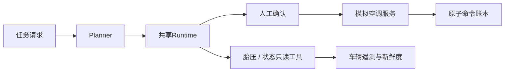

# 智能车辆服务适配与Agent执行

车辆领域扩展复用共享Agent Runtime。当前执行器为SQLite中的车辆仿真服务，已另外完成 Linux vcan 虚拟总线收发；未接入物理 CAN、ECU 或量产车辆。



## 已运行的业务链

真实LLM验收已执行：[模型轨迹](evidence/vehicle-live.json)。胎压诊断与模拟空调控制经模型规划，控制请求进入waiting_review后由演示程序显式批准，最终completed。审批为演示授权步骤，不宣称真实用户审批系统或真实车辆。

1. 读取合成胎压，返回低压轮胎、原始快照和项目阈值。220kPa仅为演示阈值，非车型标准。
2. 空调22℃请求先进入Runtime `waiting_review`；显式批准后执行并完成，命令与状态在同一事务提交。
3. 离线遥测先进入有界待传记录，恢复时模拟补传；按采样时间选择最新状态，延迟旧数据不覆盖新状态。

[原始运行证据](evidence/vehicle-baseline.json)明确标记规则Planner，不冒充真实模型。

```bash
python scripts/demo_vehicle.py --output docs/evidence/vehicle-baseline.json
python -m pytest tests/test_vehicle.py -q
```

## 核心模块与Bad Case

`src/telecom_incident_agent/vehicle.py`负责原有仿真服务和工具注册；不复制Runtime。命令账本覆盖同一SQLite事务内的仿真副作用，不宣称任意远端设备exactly-once。

## 与车载通信平台的真实集成

`src/telecom_incident_agent/sdv_services.py`不是另一套车辆 Mock。它通过 localhost UDP 上的有界 SOME/IP 子集，直接调用相邻仓库 `sdv-communication-integration-lab` 的 C++ `VehicleServiceRuntime`：

- `vehicle.state / GetSnapshot`：读取 `VehicleGateway` 汇聚后的车速、电量、车门与信号新鲜度；
- `vehicle.diagnostics / ReadDTCInformation`：只读活动 DTC、严重度、状态与发生次数；
- Agent Runtime 依次调用真实工具与项目自建诊断知识，保留每次工具结果作为证据。

客户端严格校验长度、协议版本、服务/方法、client/session 关联、返回类型与状态，设置超时和 4096-byte 上限。工具全部只读，不给模型车辆控制能力。

项目一当前 SOME/IP 合约没有暴露 Freeze Frame 和内部 Trace，因此输出明确标记两项不可用；Agent 只能分诊，不能据此虚构根因。CI 会分别启动项目一的 snapshot 与 diagnostic C++ 服务，再执行完整 Agent 链路并上传 JSON 证据。

```bash
python scripts/run_sdv_agent_integration.py \
  --sdv-server ../sdv-communication-integration-lab/build/sdv_someip_vehicle_server \
  --output .runtime/sdv-agent-integration.json
```

- 幂等键换参数：拒绝，防止同一命令身份执行不同温度。
- 离线缓冲达到容量：拒绝新样本，显式报告溢出。
- 过期遥测：返回unknown，不能依据旧胎压报告当前安全状态。
- 补传晚到：保存历史但不替换更新的采样状态。

`examples/vehicle.dbc`提供项目自建报文规范；`vehicle_signals.py`已执行该规范的unsigned little-endian经典CAN子集解码，拒绝不支持的信号格式，不是通用DBC解析器。

实际验证：[DBC记录](evidence/vehicle-dbc.json)，两帧分别解出12.34km/h、62%电量、车门状态及190kPa左前轮胎压；未知ID、错误DLC、超范围车速均拒绝。

新增五类项目自建车辆知识与版本化引用：胎压、电量、车门、空调和数据新鲜度。规则演示已执行胎压观测→知识查询→报告证据；这属于受控知识查找，不宣称大型语义RAG。

`vehicle_llm.py`已提供真实模型规划入口，通过 `demo_vehicle.py --live-model`运行。车型工具白名单、温度范围和服务端写许可独立校验，批准由共享Runtime处理。实际 LLM 结果见 [vehicle-live.json](evidence/vehicle-live.json)，与规则结果分别保存。

Linux SocketCAN/vcan 实跑已通过：[原始结果](evidence/cloud-vcan/linux-vcan.json) · [CI](https://github.com/KristenYue/telecom-network-incident-agent/actions/runs/44505903871)。真实 LLM 车辆服务验收也已完成。当前仿真补传不是实际MQTT链路；真实MQTT/TLS证据仍属于独立IoT项目。
